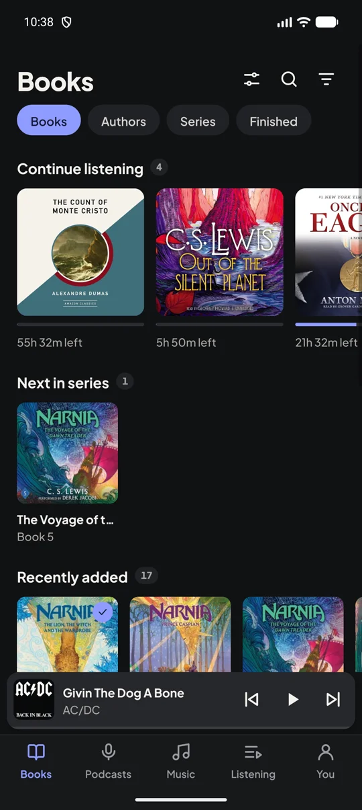
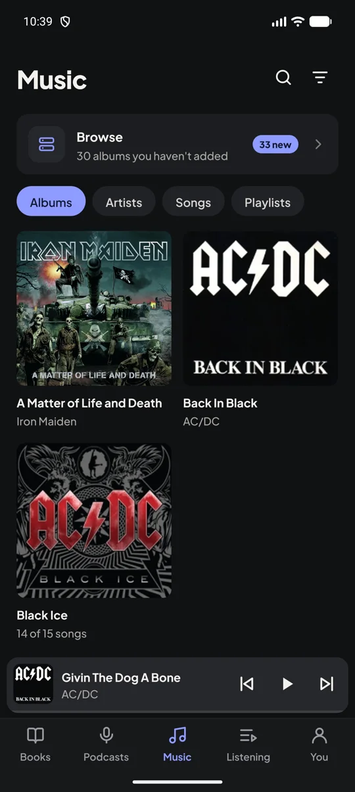
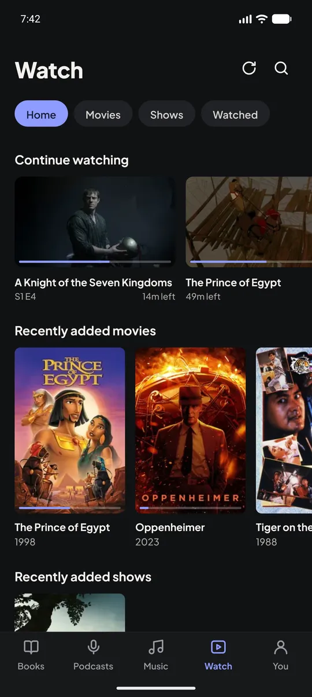
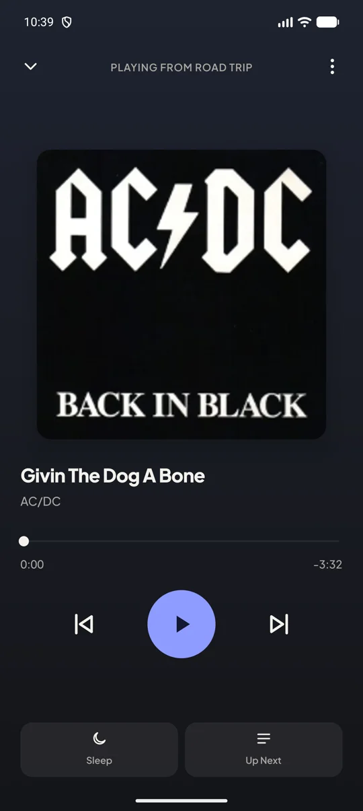
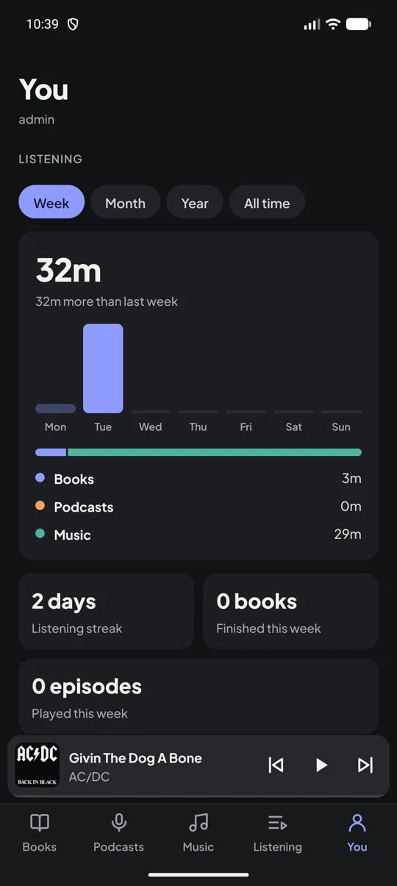

# Murmur

A self-hosted audiobook, podcast, music, movie and TV server with a web player and an Android app.

Murmur reads your audiobook folders (the Audiobookshelf layout, `Author/[Series]/Title/`), follows podcasts by RSS, plays your music and, with an optional add-on, your movies and shows, and keeps your place in sync across devices. It runs as one Docker container, plus a container for each add-on you turn on, and your library is mounted read-only: Murmur never changes your files.

<p>
  
  
  
  
  
</p>

Murmur is inspired by [Audiobookshelf](https://www.audiobookshelf.org/) and [Plex](https://www.plex.tv/). It reads Audiobookshelf's book layout and Plex's movie and show layout, so an existing library works without moving anything, and streams video the way Plex does: as it is where the device can play it, and converted on the server where it can't. It aims for a smaller feature set that's simple to run.

- **Audiobooks:** single-file `.m4b` and multi-file books, chapters, series, home shelves, a Play next shelf you put in order, and optional metadata matching from Audible (always confirmed by you).
- **Podcasts:** search or add by RSS URL, OPML import and export, Up Next, and the newest episodes kept on the server.
- **Music (optional):** albums, artists and songs read from their tags, your own music and playlists for each person, songs in Up Next, and album matching from MusicBrainz and Deezer.
- **Movies and shows (optional):** a Watch tab with Continue watching and Next episodes, from `Title (Year)` movie folders and `Show/Season` folders. Posters, descriptions and episode names come from TMDB. Files play as they are where the device can, and otherwise are converted on the server, on its GPU where it has one, with a choice of audio track, a 720p option for slow connections, the next episode lined up, and downloads to the phone. A separate add-on, `murmur-video`, does the video work; set up in [addons/video](addons/video/README.md).
- **Stats:** time spent on books, podcasts, music and video by week, month, year or all time, your streak, and what you played most.
- **Players:** a web player and an Android app with background playback, offline downloads, speed control and a sleep timer, and for video, picture in picture and a landscape player. On an iPhone, the web player can be added to the home screen to open like an app.
- **Multiple users,** each with their own progress, subscriptions, queue and music. Podcasts, Music and Watch can each be hidden by anyone who doesn't use them.
- **Optional podcast ad skipping:** a separate add-on finds the ads in episodes. Each device then chooses to play them as usual, mark them on the seek bar with a Skip ad button, or skip them automatically with Undo. Set up in [addons/adscan](addons/adscan/README.md).

## Get started

```yaml
services:
  murmur:
    image: ghcr.io/gholaday/murmur:0.6.2
    container_name: murmur
    restart: unless-stopped
    ports:
      - "3333:3000"
    environment:
      - PUID=1000
      - PGID=1000
    volumes:
      - /path/to/audiobooks:/audiobooks:ro
      # - /path/to/music:/music:ro
      # Movies and shows also need the murmur-video add-on; see docker-compose.yml.
      # - /path/to/movies:/movies:ro
      # - /path/to/shows:/shows:ro
      - /path/to/murmur/data:/data
      - /path/to/murmur/cache:/cache
```

Run `docker compose up -d`, open `http://<host>:3333`, and create the first account, which becomes the admin.

**Android app:** download `murmur-<version>.apk` from the [latest release](https://github.com/gholaday/murmur/releases/latest), or add this repository to [Obtainium](https://github.com/ImranR98/Obtainium) to get updates automatically.

[Getting started](docs/GETTING_STARTED.md) covers the rest: folder layout, remote access, installing the Android app, adding the web player to a phone's home screen, ad detection, movies and shows, and updating. The full example stack is [`docker-compose.yml`](docker-compose.yml).

## Settings

All optional.

| Variable | Default | |
| --- | --- | --- |
| `PUID` / `PGID` | `1000` | User and group that own the files in `/data` and `/cache` |
| `TZ` | `UTC` | Time zone, for the nightly backup hour |
| `DATA_DIR` | `/data` | Database, covers and backups |
| `LIBRARY_DIR` | `/audiobooks` | Development only; in Docker the volume mounted at `/audiobooks` is the first library folder. More can be added under You > Library |
| `MUSIC_DIR` | `/music` | Development only; in Docker the volume mounted at `/music` is the first music folder, added once something is there. Without one, music doesn't show |
| `MOVIES_DIR` / `SHOWS_DIR` | `/movies` / `/shows` | Development only; in Docker the volumes mounted at `/movies` and `/shows` are the first movie and show folders, added once something is there. Without them, Watch doesn't show |
| `AUDIBLE_REGION` | `us` | Store used by Match: `us`, `uk`, `ca`, `au`, `de`, `fr`, `it`, `es`, `in`, `jp` |
| `GOOGLE_BOOKS_API_KEY` | | Optional, free from the [Google Cloud console](https://console.cloud.google.com/apis/library/books.googleapis.com) (enable the Books API, then create an API key). Without one, Match shares Google's small per-address quota and may be told to wait |
| `FEED_CHECK_MINUTES` | `30` | How often each podcast feed is checked; new episodes are downloaded right after |
| `FETCH_ALLOW_PRIVATE` | `false` | Set `true` when podcast feeds or cover URLs live on your own LAN (a home server). The server's own addresses are always refused |
| `WATCH_POLLING` | `false` | Set `true` for network mounts that don't report file changes |
| `WATCH_DEBOUNCE_SECONDS` | `30` | Wait after the last file change before rescanning |
| `PERIODIC_SCAN_MINUTES` | `360` | Safety-net rescan interval |
| `MISSING_GRACE_DAYS` | `7` | Books whose files disappear are hidden after this long |
| `BACKUP_HOUR` / `BACKUP_KEEP` | `3` / `7` | Nightly database backup hour and how many to keep |
| `PROBE_CONCURRENCY` | `2` | Files read at once during a scan |
| `EPISODE_CACHE_DIR` | `/cache` | Where podcast episodes are kept |
| `EPISODE_CACHE_MAX_GB` | `20` | Space for cached episodes |
| `TMDB_API_KEY` | | Optional, free from [themoviedb.org](https://www.themoviedb.org/settings/api) (the v3 key). Fills in posters, descriptions and episode names for movies and shows |
| `TMDB_LANGUAGE` | `en-US` | Language for those details |
| `VIDEO_URL` | `http://murmur-video:3001` | Where the video add-on is |
| `UPDATE_CHECK` | `true` | Ask GitHub every 6 hours for the newest release, so Settings tells admins when an update is out. `false` turns it off |
| `ADDON_SECRET` | | Turns on the add-ons; the same value goes on `murmur-adscan` ([addons/adscan](addons/adscan/README.md)) and `murmur-video` ([addons/video](addons/video/README.md)) |

The video add-on's settings (GPU, cache and the rest) are in [its README](addons/video/README.md). The movie and show folders go into both containers at the same paths.

Health check: `GET /api/health` (and `GET /health` on the video add-on).

## Development

Needs Node 24+ and pnpm.

```bash
pnpm install
pnpm dev
```

Then open http://localhost:3000. `pnpm dev` also starts the video add-on on port 3001, which needs ffmpeg installed (on Windows, `winget install Gyan.FFmpeg`) and `ADDON_SECRET` in `apps/server/.env.local`. In development the database lives in the repo's git-ignored `data/` folder and the library is `data/audiobooks` (see `apps/server/.env.development`).

```bash
pnpm typecheck
pnpm test
```

| Folder | |
| --- | --- |
| `apps/server` | Next.js server, API and web player |
| `apps/mobile` | Expo Android app |
| `packages/shared` | Types and schemas shared by server and app |
| `addons/adscan` | Optional ad detection add-on (Python) |
| `addons/video` | Optional video add-on: ffmpeg, streams and downloads for movies and shows |
| `docs/SPEC.md` | How Murmur works and why |
| `docs/DESIGN.md` | Colours, type, components and wording |

**Releasing:** push a tag like `v0.3.0` and GitHub Actions publishes the Murmur and add-on images, and attaches the signed Android APK to a GitHub release (the tag sets the app's version). The release notes, which Settings' What's new opens, are the tagged commit's message minus its title line, so describe the changes there in plain words. Signing needs the `ANDROID_KEYSTORE_BASE64`, `ANDROID_KEYSTORE_PASSWORD`, `ANDROID_KEY_ALIAS` and `ANDROID_KEY_PASSWORD` repository secrets.

## License

Copyright (C) 2026 Garrett Holaday

Murmur is free software under the [GNU General Public License v3.0](LICENSE): you can use, change and share it, and copies you distribute, changed or not, must stay under the same license with their source available.

## Credits

Movie and show details and images come from [TMDB](https://www.themoviedb.org). This product uses the TMDB API but is not endorsed or certified by TMDB.
