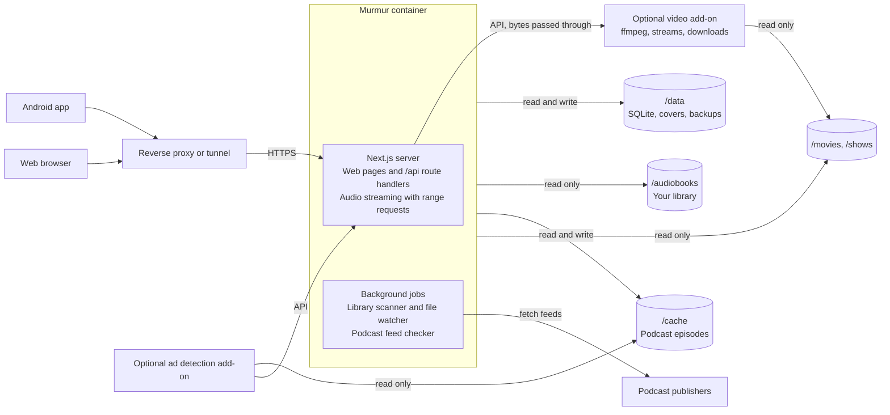

# Murmur design

How Murmur works and why. For installing it, see [Getting started](GETTING_STARTED.md).

## Overview

Murmur is a self-hosted server for audiobooks, podcasts, music, movies and TV shows, with a web player and an Android app. It reads an existing audiobook folder (the Audiobookshelf layout), follows podcasts by RSS, plays music from a folder of albums, streams movies and shows from their folders, and keeps progress in sync across devices. It runs as one Docker container.

It trades breadth for reliability: fewer features than larger media servers, each one solid.

**Principles**

- **Phone first.** The Android app is the main way to listen; the web player covers the desktop and admin work.
- **One container, one volume of state.** No separate database, cache or worker containers. Optional add-ons (ad detection, and video for movies and shows) run beside it, and Murmur works the same without them.
- **Files are the source of truth.** Folder names and embedded tags decide metadata. Online lookups happen only when an admin asks for them and confirms the result. The one exception is artist photos, which are looked up by name after a music scan (see Music).
- **Boring to run.** Pinned versions, updates are a redeploy, backups are copying one folder.
- **One language.** TypeScript across server, web and app.

## Features

**Audiobooks**

- Library with covers, sorted and filtered by author, series, recently added and progress
- Home shelves: Continue listening, Play next, Next in series, Recently added and Not started, each opening a full list. Users can reorder and hide them, saved on the server so web and app match
- Play next: books you haven't started, added from a book's menu and dragged into order in the full list (`play_next`, per person). A book leaves it once it's started, since it's in Continue listening from then on. A book on Play next isn't repeated in Next in series or Not started. Books never go in Up Next, and when a book ends, playback stops
- Book page: cover, author, narrator, series and position, description, duration, chapter list
- Single-file `.m4b` and multi-file books, played as one continuous timeline
- Automatic rescan when files are added, moved or removed
- One or more library folders, managed by the admin under You > Library (seeded from `LIBRARY_DIR` on first start), each checked before it's saved
- Mark finished, reset progress
- Metadata Match and editing for admins (see Metadata)

**Podcasts**

- Find podcasts by name (Apple's public podcast search, no API key needed) or paste an RSS feed URL; OPML import and export
- Feeds are checked on a schedule (default every 30 minutes, and once at startup)
- Episodes stream through the server, which keeps the newest episodes of each followed show on disk (see Podcast episode cache and ad detection); the phone can download any episode
- Up Next queue, and played, unplayed and archived states per episode
- Optional ad detection: ads marked on the seek bar, Skip ad, or Auto-skip with Undo

**Music** (optional; see Music)

- Music folders managed by the admin under You > Library (`/music` is added on its own once it's mounted); with none, music doesn't show anywhere
- Albums, artists and songs from the tags, with covers from the folder or the files
- Your music: each person adds the albums or songs they want, and Browse has the rest
- Play or shuffle an album, an artist's songs, your songs or a playlist, with the next song loaded early so albums play without a gap
- Playlists of your own, and single songs in Up Next
- Download albums or songs to the phone
- Album Match and artist photos for admins

**Watch** (optional; see Watch)

- Movie and show folders managed by the admin under You > Library; with none, Watch doesn't show. A Video row there says whether the video add-on works and what converts video (`watch.status` in `/api/health`, worded by the server for the web and the app)
- TMDB's logo and notice under You > Server while Watch is on, as TMDB's terms ask
- Posters, descriptions and episode names from TMDB when a key is set, matched on their own like Plex, with Match to fix a wrong one
- Plays the file as it is when the device can, else streams it through ffmpeg with the sound or the picture converted, on the GPU where there is one
- Quality (1080p or 720p) for converted video, picked per video or as a setting; audio track choice; the next episode with a countdown (Play next episode turns it off)
- Download movies and episodes to the phone

**Listening stats**

- On You: time listened and watched this week, month, year or all time against the period before, a chart stacked by books, podcasts, music and Watch, your streak and daily average, a count for each kind, and what you played and watched most. Picking a kind in the legend shows only that kind
- Kinds whose tab is hidden, or that the server doesn't have, are left out of the stats altogether, the total included
- Podcasts and Music can each be hidden per person under Tabs; their tabs and their parts of You go away

**Player**

- Mini player, expanding to a full-screen player tinted from the cover
- Skip back and forward (configurable, defaults 10 s and 30 s), chapter skip. On an episode without chapters, previous and next (in the player, media keys and the notification) go to the item before or after it in Up Next, and past either end to the episode above or below it in its show's list (`GET /episodes/:id/neighbor`). Previous restarts the episode first once it's more than 3 s in
- Playback speed 0.5× to 3× (2× on Android), remembered per book and per show
- Sleep timer: minutes or end of chapter
- Volume slider and mute in the web player on desktop, remembered per browser (phones use their own buttons)
- Lock screen, notification, Bluetooth and headphone controls in the app

**Sync and offline**

- Listening position saved to the server every few seconds and on pause
- Resume on any device where you left off
- Download books, episodes, music, movies and TV episodes to the phone; offline progress syncs when back online

**Accounts**

- Multiple users, each with their own progress, subscriptions, queue, music and playlists
- The first account is the admin, who manages users and library settings
- Login with username and password; the app keeps a long-lived token

## Tech stack

| Layer | Choice | Why |
| --- | --- | --- |
| Server and web UI | Next.js (App Router), self-hosted with `standalone` output | Route handlers serve the API, pages serve the web player |
| Database | SQLite via `better-sqlite3` + Drizzle ORM | A single file in `/data`; typed queries and migrations |
| Background jobs | Started from `instrumentation.ts` with `node-cron` and `chokidar` | Feed checks and library watching inside the same process |
| Audio metadata | `music-metadata` (pure JavaScript, no ffmpeg) | Reads tags, duration, chapters and embedded covers from m4b, mp3, flac and ogg/opus |
| Video | `ffmpeg` and `ffprobe`, with the VAAPI drivers, in the video add-on's image (`addons/video`) | Reads video files, grabs stills, and makes HLS streams and downloads; only Watch needs them, and Murmur's own image has no ffmpeg |
| RSS | `rss-parser` | Parses podcast feeds and iTunes tags |
| Auth | Session cookie for web, bearer token for the app; passwords hashed with argon2 | Simple, no external provider |
| Web styling | Plain CSS with custom properties (`apps/server/src/app/globals.css`) | Light and dark themes without a build step |
| Android app | Expo (React Native) + Expo Router | React and TypeScript; shares types with the server |
| App playback | `expo-audio` | Background audio, lock-screen and notification controls, Bluetooth buttons |
| App downloads | `expo-file-system` | Offline books, episodes, music, movies and TV episodes |
| App data | TanStack Query persisted to `expo-sqlite` key-value storage | Cached lists that open offline, offline progress queue |
| Shared code | `packages/shared`: API types and Zod schemas | One definition used by server, web and app |
| Repo | pnpm workspace monorepo | `apps/server`, `apps/mobile`, `packages/shared`, `addons/adscan`, `addons/video` |

All dependency versions are pinned; upgrades happen deliberately, not on every rebuild.

## Architecture

Everything runs in one Next.js process: the web pages, the JSON API the app calls, audio streaming and the background jobs.



Podcast episodes are served from the server's episode cache, falling back to relaying the publisher's audio with range requests. The optional ad detection add-on runs as a second container (see Podcast episode cache and ad detection), and so does the video add-on (see Watch).

**Data model** (SQLite)

| Table | Holds |
| --- | --- |
| `users` | Username, password hash, admin flag |
| `sessions` | Web sessions and app tokens |
| `library_folders` | The folders the library is read from |
| `books` | Title, author, narrator, series, position, description, duration, cover path, library folder and path inside it, file hash |
| `book_files` | Each audio file in a book: path, order, duration, start offset |
| `chapters` | Title, start and end time per book |
| `podcasts` | Feed URL, title, author, artwork, last checked |
| `episodes` | GUID, title, publish date, duration, audio URL |
| `progress` | Per user and item: position, finished flag, last updated, speed |
| `up_next` | Per user: Up Next as one running list of episodes and songs, with the one playing |
| `play_next` | Per user: the ordered Play next books |
| `episode_files`, `episode_ads`, `ad_scans` | The episode cache and ad times (see Podcast episode cache and ad detection) |

**API** (all under `/api`, JSON, token or cookie auth)

| Area | Endpoints |
| --- | --- |
| Auth | `POST /auth/setup` (first run only), `POST /auth/login`, `POST /auth/logout`, `GET /me`, `GET/PUT /me/prefs` |
| Library | `GET /books`, `GET /books/:id`, `GET /books/:id/cover`, `POST /library/scan` |
| Book editing (admin) | `GET /books/:id/edit`, `PUT /books/:id/details`, `PUT /books/:id/chapters`, `POST/DELETE /books/:id/cover`, `POST /books/:id/rescan`, `GET/POST/DELETE /books/:id/match` |
| Streaming | `GET /stream/book/:id/:fileIndex`, `GET /stream/episode/:id` (range requests) |
| Podcasts | `GET/POST /podcasts`, `GET /podcasts/search?q=` (directory search, marks podcasts you follow), `GET /podcasts/preview?feedUrl=` (reads a feed without subscribing), `DELETE /podcasts/:id`, `GET /podcasts/:id/episodes`, `POST /podcasts/:id/refresh`, OPML import and export |
| Progress | `GET /progress?since=`, `PUT /progress` (batched, newest update wins) |
| Up Next | `GET /up-next`, `PUT /up-next` (the whole list), `PATCH /up-next` (where it's at), `POST /up-next` (add one item, or several in order) |
| Play next | `POST/DELETE /books/:id/play-next`, `PUT /play-next` (order) |
| Admin | `GET/POST/DELETE /users`, `GET/PUT /library/folders`, `POST /library/folders/check`, `GET /library/browse?path=` |
| Episode cache and ads | `GET /episodes/:id/ads`; admin: `GET/PUT /server/cache`, `POST /server/ads/retry` |
| Add-on (shared secret) | `POST /addon/ads/next`, `POST /addon/ads/:fileId`, `POST /addon/status` |
| Health | `GET /health` (no auth): database, library, scan and watcher status, version, and whether ad detection is on |

Conflicts in progress sync resolve to the most recent update by timestamp, so listening offline on the phone and then online in the browser keeps the newer position.

## Performance and reliability

The bar is high: every screen opens instantly, playback starts in about a second, and nothing breaks without someone touching it.

**Targets** (a low-power home server with a 1,000-book library)

| Measure | Target |
| --- | --- |
| Server cold start to ready | under 3 s |
| Library list API, p95 | under 50 ms |
| Playback start, LAN / remote | under 1 s / under 2 s |
| Full rescan, nothing changed | under 5 s |
| Memory at idle | under 200 MB |
| Docker image size | under 350 MB |
| App: library screen open, cached | under 300 ms, works offline |

**Server speed**

- SQLite in WAL mode with indexes on every lookup column; the library list is one query, not one per book.
- No transcoding: audio is streamed byte for byte with range requests, so playback costs almost no CPU.
- Covers are resized once at scan time (200 px and 600 px WebP) and served with a content hash in the URL and a one-year immutable cache header.
- JSON responses carry ETags, so unchanged data returns `304 Not Modified` with no body.
- Incremental scans: only files whose size or modified time changed are probed again, at most 2 at a time so a big import doesn't swamp the disk.
- Progress updates are tiny writes, debounced on the client to one every 10 s plus on pause.

**App speed**

- Library, podcasts and progress are cached on the phone, so screens draw from local data first and refresh in the background.
- Long lists use virtualized rendering (FlashList); covers load through `expo-image` with disk caching.
- Progress is written on the phone first and synced after, so a flaky connection never stalls the player.

**Safeguards**

- **Never lose progress.** Progress rows are never deleted when a book disappears; if the book comes back, so does your place.
- **Survive a storage hiccup.** If a library folder is empty or unreachable, the scanner leaves its books alone and reports the problem in Settings; the other folders still scan. Missing books are marked missing and only hidden after 7 days. Removing a folder in Settings removes its books on the next scan, unless they turn up in another folder, which keeps their progress.
- **Safe updates.** Migrations run in a transaction after copying the database to `/data/backups`; a failed migration rolls back and the old image still works.
- **Nightly backup** of the database to `/data/backups`, keeping the last 7.
- **Health check.** `/api/health` reports database, library mount and job status for Docker's health check. A fatal error exits the process so the restart policy brings it back.
- **Clean shutdown.** On stop, pending writes are flushed and the database closed, so a redeploy can't corrupt it.
- **Podcast feeds are isolated.** Each check has a 15 s timeout, retries with backoff, and uses conditional requests; one broken feed never blocks the rest.
- **Bounded logs**: one JSON line per event to stdout, rotated by Docker's log settings.
- **Few dependencies,** all pinned.
- **Tested before release.** A small set of unit tests covers the rules that matter most (folder and title parsing, file ordering, chapter timing, range requests, match scoring, cache eviction, ad spans); no integration tests. CI must pass before an image is published.

## Library scanning rules

The scanner follows the Audiobookshelf folder layout, so an existing library works without moving files.

**Accepted layouts** (relative to a library folder)

```
Author/Title/book.m4b
Author/Title/01.mp3, 02.mp3, ...
Author/Series/Title/...
Author/Series/Book 3 - Title/...
```

**Rules**

1. A **book** is a folder that directly contains audio files (`.m4b`, `.m4a`, `.mp3`, `.flac`, `.ogg`, `.opus`).
2. One `.m4b` file = one book; its embedded chapters are used.
3. Several audio files = one multi-file book, ordered by track tag, then disc tag, then natural filename sort. Each file becomes a chapter unless embedded chapters exist.
4. Path depth 2 (`Author/Title`) = no series; depth 3 (`Author/Series/Title`) = series name from the middle folder.
5. A leading number in the title folder (`Book 3 - Title`, `03. Title`) sets the series position.
6. Cover art: `cover.jpg` or `cover.png` in the folder, then the first image file, then embedded art.
7. Optional `desc.txt` (description) and `reader.txt` (narrator) are read, matching Audiobookshelf.

**Metadata priority:** embedded tags (title, author, narrator, year, description) win over folder names, except that folder names always decide author and series grouping, so one mis-tagged file can't split a series.

**Identity:** a book is keyed by its folder path plus a hash of its file list, so progress survives a rescan and renaming a file inside a book doesn't lose it. Moving a book folder is detected by matching the file hash.

**Scans:** a full scan on startup and on demand from Settings; between scans, a file watcher picks up changes after 30 s of quiet. Network mounts that don't report changes can use polling (`WATCH_POLLING`), and a periodic rescan is the safety net.

## Metadata

Metadata comes from your files first; an optional Match button fills gaps from online sources, and only when you confirm it.

**Layer 1: local, always on** (done by the scanner)

| Field | Source, in priority order |
| --- | --- |
| Title | Embedded title tag, then the folder name minus any series number |
| Author | Author folder (decides grouping); embedded artist tag shown if it differs |
| Narrator | `reader.txt`, then the composer or narrator tag |
| Series and position | Series folder and the leading number in the title folder, then the grouping tag |
| Description | `desc.txt`, then the comment or description tag |
| Year | Date tag |
| Duration and chapters | `music-metadata` on the audio files (constant-bitrate MP3 lengths from size and bitrate) |
| Cover | `cover.jpg` or `cover.png`, then any image in the folder, then embedded art |

**Layer 2: online match, on demand** (admin only)

1. From a book page or a library card's options menu, open **Match metadata**. The server searches Audible's catalog by title and author, with Google Books as a fallback.
2. You pick the right result from a list with covers.
3. The match fills only empty or poor fields (missing cover, description, narrator, series, a better chapter list from Audnexus). Fields you don't tick are left alone, and **Undo match** in the book menu returns to the file metadata.
4. Matched data is stored in the database as an override; your files are never modified, and a rescan never undoes a match.

Nothing is applied without your confirmation. The Audible and Audnexus lookups are unofficial APIs, so if they break, matching degrades and everything else keeps working.

**How matching stays consistent**

The same book always gets the same answer, and a weak answer is shown as weak instead of applied.

1. **IDs first.** If a file's tags or the folder name carry an Audible ASIN or an ISBN (Libation and OpenAudible downloads usually do), look it up directly.
2. **Clean the query.** Strip series numbers, "Unabridged", years, bracketed tags and narrator names from the title; normalize accents, punctuation and author name forms ("J.R.R. Tolkien" equals "J. R. R. Tolkien").
3. **Gather candidates** from Audible (region set by `AUDIBLE_REGION`, default US), then Google Books only when Audible has nothing scoring 70 or more. Provider responses are cached for 30 days, and a stale cached answer is used if a provider is down.
4. **Score every candidate** on the same weighted checks:

| Signal | Weight | Why it matters |
| --- | --- | --- |
| Duration within 2% of the local files | High | Tells unabridged from abridged and dramatized editions |
| Author name match | High | Stops same-title books by other authors |
| Title similarity after cleaning | High | Core match |
| Narrator match | Medium | Separates re-recordings |
| Series name and position match | Medium | Picks the right book in a series |
| Language | Low | Avoids translated editions |

5. **Act on the score.** 90 or above: pre-selected as the suggestion. 70 to 89: candidates listed, nothing pre-selected. Below 70: "No confident match", with a manual search box.
6. **Review before apply.** A side-by-side view shows current and proposed values per field, with checkboxes. Empty or poorer fields are ticked by default; titles and authors never are.
7. **Safe merge rules.** A new cover is only suggested when it is larger than the current one. Online chapter lists are only applied when their total length matches the files within 1%, so chapter marks can't drift.
8. **Remember the result.** The chosen ASIN is stored, so later refreshes are exact lookups.

**Layer 3: editing by hand** (admin only, web)

Every book card has an options menu (Play, Add to Play next for books not yet started, Mark as finished, and for admins Edit details, Change cover, Match metadata, Rescan files). The edit dialog has five tabs:

| Tab | What it does |
| --- | --- |
| Details | Title, author, narrator, series and book number, year, description. A changed field is marked Edited, shows what the files say, and can be reset |
| Cover | Upload an image, use an image link, or pick a cover from the online results; go back to the files' cover at any time |
| Chapters | Rename chapters, change start times, add or remove them; or go back to the files' chapters |
| Match | The online match above, inside the dialog |
| Files | The book's folder and files with length, size and bitrate; rescan this book; undo every edit and match |

Edits are stored in the same override row as a match, so a rescan keeps them and the files are never touched. An admin-only **Needs attention** view lists books with no cover, no author or missing files.

**Podcasts:** show and episode titles, artwork, descriptions and durations come from the RSS feed itself.

## Music

Music is optional. It comes from one or more music folders, managed by the admin under You > Library, next to the book folders. The first, `MUSIC_DIR` (`/music` by default), is added once something is mounted there, and only once, so a folder the admin removes stays removed. No folder may sit inside another of either kind, so nothing is scanned twice. With no music folder, nothing about music shows anywhere.

**Scanning**

- Music is read file by file, not folder by folder, and a file is probed again only when its size or modified time changes. It has its own watcher and the same missing-file grace period as books.
- Albums are grouped by album artist plus album title. The album artist falls back to the song's artist. A song by someone other than the album artist (a compilation or a feature) is filed under the album and listed on its own artist's page under Appears on.
- **Untagged files:** the folder is the album, its parent folder the artist, and the file name the title. A leading `01 - ` is the track number, and `CD 1` or `Disc 2` folders belong to the album above them.
- **Covers:** `cover.jpg`, `folder.jpg` or `front.jpg` in the album folder, else the first song's embedded picture.
- Older ID3 tags split "AC/DC" on the slash. The parts are joined back when the joined name is the album artist.
- The grouping rules are in `music/parse.ts`, with unit tests.

**Your music**

- Music is per person: a list of songs (`user_tracks`), and everyone starts with none. Adding an album adds its songs. Album and artist state is worked out from the songs, so nothing else is stored.
- The Music tab shows your music as Playlists, Albums, Artists and Songs, opening on Albums. Browse, above the chips, has every album, filtered to All, Not added, or New (found in the last 14 days). The UI never mentions the server.
- Lists take `scope=mine` or `scope=all`; the server defaults to `all`.
- There's no following of artists, so songs the server gets later aren't added for you.

**Playback**

- A song always plays from the start at 1×, keeps no position and is never marked finished. It counts as played after 30 seconds or half its length, whichever is shorter (`track_plays`, kept per person with no foreign key, like progress).
- Playing an album, an artist's songs, your songs or a playlist fills Up Next with its songs (see Up Next below) and remembers where they came from and their own order, for Shuffle.
- While that music is playing, its Play button turns into Pause and Resume, like a book's.
- Shuffle and Repeat work like Spotify's and are kept in your settings (`shuffle`, `repeat` in `users.prefs`), so they stay on between sessions and devices. The player for songs shows Repeat left of Previous and Shuffle right of Next, in the accent colour when on. The round Shuffle beside Play lights up while Shuffle is on; it turns Shuffle on and plays, or just toggles it when on or when that music is already playing.
  - With Shuffle on, Play starts on any song, and tapping a song plays it first and then the rest shuffled.
  - Turning Shuffle on mid-play moves the item playing to the top, with nothing above it, and shuffles all the album's other songs after it, in a new order each time. Songs you added that are still to come and waiting episodes keep their places. Turning it off puts the whole album back in its own order around the song playing: the songs before it go above it and the ones after it are still to come.
  - Repeat goes off, all, one. Repeat one replays a song that ends by itself; pressing Next moves on and switches to Repeat all. Repeat all starts Up Next over from the top.
- Previous restarts the song after 3 seconds. Otherwise it goes back one item in Up Next, and on Repeat all the first goes round to the last.
- Two players take turns: the spare one loads the next song 10 seconds before the end and takes over at once.
- Previous and next step through songs in the player, the media session and the notification. Speed is hidden. Shuffle and Repeat are only in the player, not the app's notification or Android Auto (both read the same media session).
- Song time counts in the listening stats as Music.

**Playlists and Up Next**

- Playlists are each person's own (`playlists`, `playlist_tracks`). A playlist plays as its own context, and its songs can be reordered by dragging, removed, renamed or deleted. `.m3u` files in the music folders are not read.
- A playlist's + button (and Add songs on an empty one) opens Add songs: search your songs, what you played recently (`GET /music/plays`) or Browse, and tap + to add a song to the end or its check to take it out, with Undo. Songs from Browse join the playlist without being added to your music.
- Every song has a menu: Add to Up Next (Remove from Up Next while it's waiting there), Add to playlist, Go to album. An album's menu and a playlist's also have Add to Up Next, which adds all their songs in order.

**Up Next**

One running list of songs and episodes, like YouTube Music's (`up_next`, one row per person: the items in order, which one is playing, and where the songs came from). The rules are shared (`packages/shared/src/up-next.ts`).

- What played stays above the item playing and what's next follows it. The sheet opens on the item playing.
- Tapping a row plays it; tapping the one playing pauses and resumes. Any row, played or not, can be dragged to a new place or taken out. Taking out the one playing starts the one after it.
- Starting an album, artist, your songs or a playlist replaces the list with its songs. Starting an episode from its show, or a book, does the same with nothing but that episode. Either way, episodes you added that haven't played yet stay, after the new songs.
- Add to Up Next on a song puts it right after the item playing and anything you added just before; an episode goes at the end. Something already waiting moves instead of doubling up.
- When an item ends, the next one plays. Books are never in the list: one playing sits above it, and when it ends, playback stops.
- Clear empties what's still to come, with Undo.
- Lists from before 0.5 (the album in `play_context` and the queue in `queue_items`) carry over the first time each person opens Up Next.

**Downloads (app):** a whole album or one song. Downloaded has a Music section, and downloaded music plays offline.

**Matching (admins)**

The books pattern, for albums: "Match metadata…" in an album's menu, and Match all under Browse's Not matched filter, with the same dialog, compare table and review screen as books.

- **Sources:** MusicBrainz (covers from the Cover Art Archive) and Deezer are searched together. Apple Music is asked only when neither has a result scoring 70 or more. All three are free with no key, and go through the 30-day provider cache. On a tie, MusicBrainz wins, because Deezer and Apple often list a reissue's year. MusicBrainz is held to one request a second, with one retry when it's busy.
- **Scoring** (`music/match-score.ts`, with tests): title 40, artist 35, song count 25. Edition words ("Deluxe", "Remastered") and catalog numbers ("[2156]") are left out. A different song count is never suggested.
- **Fields:** cover (only when bigger), title, year, genre, and song titles and numbers. Songs are offered only in a single album's Match, and only when the result has the same number of songs; they're paired by position. Match all only fills a missing year or genre and never touches songs.
- Values go in `album_overrides` and `track_overrides`, so a rescan keeps them. Undo match removes both.

**Artist photos**

- After each music scan, Deezer is searched by name for album artists with no photo. A match counts only when the names are the same once normalised; with several, the one with the most fans wins. Nothing found is tried again after 30 days.
- Photos are kept in `artist_photos` by name key, so a rescan that recreates the artist keeps them. Without one, the artist shows their newest album's cover.
- "Change photo…" on the artist page (admins) picks another or goes back to the album cover.

**Rejected:** audio fingerprinting (AcoustID needs `fpcalc` in the image and decoding every file), and TheAudioDB and fanart.tv (both need API keys).

## Watch

Movies and TV shows, built on the `watch` branch. [WATCH.md](WATCH.md) has the full design: folder layout, scanning, matching, streaming and the players. In short:

- **The video add-on.** ffmpeg lives in its own container, `murmur-video` (`addons/video`, TypeScript on plain `node:http`), the way ad detection lives in `murmur-adscan`. Murmur keeps the library walk, the database, TMDB matching, art and the routes, and calls the add-on over HTTP with the add-on secret to probe files, grab stills, and make streams and downloads, whose bytes it passes through to the player. Both mount the movie and show folders at the same paths. Without the add-on, Watch stays empty, the scan says why, and nothing else is affected.
- **Folders.** Movies go in "Title (Year)" folders and shows in Show/Season folders, each kind under its own library folders. ffprobe reads each file once, and again only when its size or modified time changes.
- **Details.** Local art and .nfo files come first. With `TMDB_API_KEY` set, everything not yet tried is matched after each scan, one request at a time, and Match fixes a wrong one. A still is grabbed for each file without one: a tenth of the way in, or the brightest of a few later frames when that one is dark.
- **Playing.** `playbackPlan` (shared) decides per device. A file the device plays as it is plays directly, with range requests. Otherwise an ffmpeg HLS session copies the picture, or converts it to H.264, from wherever playback starts, and converts the sound to AAC when needed. A far seek starts a new session. A session keeps only about three minutes behind the player on disk, and nothing once it ends.
- **Converting.** The first working encoder is used: NVENC, Quick Sync, VAAPI, AMF, VideoToolbox, then the CPU. A GPU that fails on a file is dropped for the CPU. Quality is 1080p or 720p, picked per video or as a setting under You > Playback.
- **Progress and stats.** Progress is saved like a book's, with `itemType: "video"`. Watching adds to the same listening totals as audio, so it shows on You and counts towards the streak.
- **Downloads.** The phone keeps the file as it is when it can play it. Otherwise the server makes an MP4 into its cache as a job the phone checks on, then the phone downloads it like any file and the server deletes its copy. One conversion per person runs at a time.

## Android app

The layout follows the familiar podcast-app pattern: bottom tabs, a persistent mini player, and a full-screen player tinted from the cover art. The design system is in [DESIGN.md](DESIGN.md).

**Screens**

| Tab or screen | Contents |
| --- | --- |
| Books | Home shelves, then books by title, author or series, and finished; search and filters |
| Podcasts | Subscribed shows with unplayed counts and new episodes; search or add a show by RSS URL |
| Music | Your albums, artists, songs and playlists, with Browse for the rest |
| You | Downloaded at the top in the app (what's saved on the phone, with its size), then Stats and Settings tabs: Stats has the listening stats and your library counts, Settings has account, appearance, playback, server, tabs, and admin settings |
| Book, show, album, artist or playlist page | Header with cover and colour band, description, chapters, episodes or songs, download and play buttons |
| Full-screen player | Large cover, chapter or song name, scrubber, speed, sleep timer, skip buttons, chapter list, and an Up Next tile with what's still to come that opens the running list (what played, what's playing and what's next; drag to reorder, remove, Clear) |

Podcasts and Music can be turned off under You > Tabs; Books and You are always there.

**Look and feel:** dark theme by default with a light option; periwinkle accent (#8E9BFF on dark, #4F5BD5 on light); the player background takes its colour from the cover; large touch targets.

**Playback:** `expo-audio` runs as a media session service so audio keeps playing with the screen off, with lock-screen and notification controls. One player is shared by the whole app; a multi-file book plays file by file on one continuous timeline. Streams use the server's range-request endpoint with the app's token, and downloaded files play from local storage. Limits of `expo-audio` on Android: speed goes up to 2×, and the lock-screen and headset skip buttons always move 10 seconds (the in-app skip buttons use the lengths set in Settings).

**Android Auto:** a pnpm patch to `expo-audio` turns the playback service into a media library service, and the `with-android-auto` config plugin adds the manifest entries. Auto shows Now playing and, while the Music tab shows, Music with Playlists, Albums, Artists and Songs. The app answers those lists from its saved copies, so they work offline. A picked song plays its album, artist or playlist like the app, with previous and next. Cover art reaches Auto as `content://` links from a read-only provider, because it can't open the app's own files or authenticated links. One media session lasts across songs and books, so Auto stays connected.

**Offline:** lists and opened pages are cached on the phone, so the app opens and downloaded items play without a connection. Progress is written to a local outbox first and sent to the server when it's reachable.

**First run:** enter the server URL, then username and password; the app stores a token and never asks again until it's revoked.

**Distribution:** an APK installed directly, built with EAS Build or locally with Gradle.

## Podcast episode cache and ad detection

The server keeps recent episodes of every followed show on disk, so everyone streams the same copy. An optional second container finds the ads in those copies, and the players can mark or skip them. Ad detection is decoration: if any part of it is missing or broken, podcasts play exactly as before, just without ad marks.

### Episode cache (part of Murmur)

Dynamically inserted ads differ on every download, so ad times only hold for one copy of the file. The cache makes that one copy the one everyone hears. It is useful without the add-on, since episodes start faster and don't depend on the publisher's server while playing.

- **What gets downloaded.** After each feed check, the newest 3 episodes of every show anyone follows. Admins change the 3 in Settings ("Episodes kept ready per show"; Off turns prefetching off). Downloads are per episode, so a show five people follow is fetched once.
- **What doesn't.** Episodes every follower has finished or archived, and shows nobody follows.
- **One download at a time,** with a 60 s stall timeout and up to 3 tries with backoff. An episode that still fails is streamed by relaying.
- **On demand.** Playing an episode that isn't cached starts its download, and playback reads the growing file. A range that isn't on disk yet waits for the download (which runs far faster than playback) rather than being relayed, because a relayed range could come from a different copy with different ads. If the download fails, the stream falls back to relaying the whole episode, without ad marks.
- **Serving.** `/api/stream/episode/:id` serves the cached copy when there is one. Phone downloads come from the same file, so their ad times match.
- **Storage.** Episodes live in their own mount, `/cache`, kept out of `/data` so backups stay small. `EPISODE_CACHE_MAX_GB` (default 20) caps it.
- **Eviction** when over the cap: never an episode that is in anyone's Up Next, in progress, or among a show's newest 3. Episodes everyone finished go first, then the least recently played. An episode's ad times are deleted with its file.
- **Failure.** If `/cache` is missing, full or unwritable, Murmur relays streams as before and shows the problem in Settings. `/api/health` reports it without failing, so Docker doesn't restart the container over it.

### Ad detection add-on (optional container)

A second service in the same stack, `murmur-adscan` (source in `addons/adscan`). Without it, Murmur behaves exactly as it does with it switched off.

**How it works**

1. **Take the next episode.** The add-on asks Murmur for work (`POST /api/addon/ads/next`) and gets an episode, its file path under `/cache` and its length. The job is leased for 30 minutes. Murmur picks in this order: something being played right now, then episodes in anyone's Up Next, then prefetched episodes, newest first.
2. **Transcribe.** The cached file is read read-only, 30 minutes at a time. Each piece goes to Groq (hosted Whisper large-v3-turbo, as a 32 kbps mp3). When Groq is not set up, is down, or its audio allowance would mean waiting more than 15 minutes, that piece is transcribed locally by Vosk (small English model) instead. Each piece's transcript is saved to the add-on's own `/state` volume, so a restart or a Gemini outage never redoes finished pieces.
3. **Find the ads.** Each piece goes to Gemini as text (eight-word lines with start and end times) as soon as it is transcribed, running 2 minutes into the next piece so an ad break on a cut is seen whole. Copies of an ad found in two pieces are merged.
4. **Check the answer.** Spans with the end before the start, outside the episode, or longer than 5 minutes are dropped, and spans running past the end are cut to it.
5. **Report.** Spans are posted per piece (`POST /api/addon/ads/:fileId`), so the first marks appear minutes after a scan starts, not after the whole episode.

Each span has a start, an end, a kind (`inserted`, `host_read` or `promo`), the advertiser if named, and its first words.

**Why this approach** (benchmarked on a 70-minute episode with 20 ads)

| Approach | Result | Cost per hour of audio |
| --- | --- | --- |
| Groq Whisper transcript to Gemini Flash-Lite as text | All 20 ads, with clean text (names, advertisers, promo codes) | Free within Groq's allowance, plus about 1 cent of Gemini if paid |
| Vosk transcript to Gemini Flash-Lite as text | All 20 ads, edges within about a second | About 23k tokens, about 1 cent if paid |
| Parakeet TDT 0.6B locally | Transcripts as good as Groq's | Free, but about 1.4 GB of memory |
| Whole audio to Gemini | Missed most ads in one run, invented ads past the end of the episode | About 90k tokens, about 3 cents |
| Keyword rules on a transcript | Missed any ad without a stock phrase | Free |
| Whisper locally on a CPU without AVX | Tiny 0.4x, base 0.2x real time: can't keep up | Free |

Groq transcribes 30 minutes in about 15 to 25 seconds. Its free tier allows about 2 hours of audio per hour and 8 per day; the add-on paces itself under that, so a big backlog spreads over the day, with Vosk covering what doesn't fit. Vosk runs at about 5x real time on a 4-core Celeron (about 12 minutes per hour of audio, about 500 MB of memory). At about 23k tokens per hour, normal use fits Gemini's free tier.

**Settings** (environment variables, add-on only)

| Variable | Default | |
| --- | --- | --- |
| `MURMUR_URL` | `http://murmur:3000` | Murmur inside the stack (its container port) |
| `ADDON_SECRET` | | The same value as Murmur's. On Murmur, this one variable is the on switch: without it there are no add-on endpoints, no scans and no ad settings |
| `GEMINI_API_KEY` | | Required. Lives only here, never in Murmur |
| `GEMINI_MODEL` | `gemini-flash-lite-latest` | Google's alias for its newest Flash-Lite, so retirements don't break the add-on. When it moves to a new model, prices and free-tier limits can change with it. Set a fixed model to pin one |
| `GEMINI_RPM` / `GEMINI_TPM` / `GEMINI_RPD` | 10 / 200,000 / 400 | The add-on paces itself under these; defaults sit below the free tier's limits |
| `GROQ_API_KEY` | | Optional, recommended. Without it every piece uses Vosk. Lives only here |
| `GROQ_MODEL` | `whisper-large-v3-turbo` | |
| `GROQ_AUDIO_PER_HOUR` / `GROQ_AUDIO_PER_DAY` | 7,200 / 28,800 | Seconds of audio; Groq's free-tier limits. Raise them on a paid plan |

The example stack gives the add-on a CPU limit, and it scans one episode at a time.

**Failure handling.** Nothing in playback, streaming or the cache ever waits on the add-on.

| Failure | What happens |
| --- | --- |
| Groq down, its limit reached, its allowance used up, or its key refused | That piece uses Vosk. Settings shows "Transcribing with Vosk" with the reason, and until when if known. A refused key is tried again hourly |
| Gemini rate limit (per minute), 500, 503, network error | Retry with backoff and jitter, using the delay Gemini suggests, up to 5 times; then the piece goes back in the queue for later |
| Gemini daily limit | Gemini calls pause until it resets (midnight Pacific). Transcription carries on, so the backlog is ready to send |
| Bad key, billing problem, model retired (400, 401, 403, 404) | Gemini calls stop and the status shows the error. Checked again hourly and on restart |
| Unreadable or nonsense answer | That piece is retried once, then marked failed; one bad span never drops the others |
| Episode file missing from `/cache` | The scan fails and Settings says the cache folder isn't mounted where the add-on expects it |
| Add-on crashes or restarts | On its first report after starting, Murmur puts what it was scanning back in the queue, and saved transcripts mean it resumes where it stopped. If it never comes back, the 30-minute lease runs out instead |
| Add-on stopped or missing | Episodes simply have no marks. Settings shows "Not connected" after 15 minutes without contact |
| Murmur unreachable from the add-on | The add-on keeps its results and posts them when Murmur is back |
| Episode re-downloaded | Ad times belong to one cached file; a new file drops the old times and is scanned again |

Each episode has a scan status: queued, scanning, done or failed, with the attempt count and last error. After 3 failed attempts an episode stops being retried until an admin presses Retry.

### Player and settings

- **Marks.** Ad spans are drawn on the seek bar in the web player and the app.
- **Modes,** set per device (each browser and each phone keeps its own), with an optional per-show override on that device. For example, Auto-skip on the phone in the car and Show on the desktop.
  - **Off:** no marks.
  - **Show** (default): marks, plus a Skip ad button on the cover's corner while an ad plays, so nothing else on the player moves.
  - **Auto-skip:** playback jumps past the break when it runs into an ad's start, and a "Skipped ad" toast offers Undo for 5 seconds. Undo goes back to the start and doesn't skip that break again during this listen. An ad at 0:00 counts as run into when playback starts from the beginning.
- **No surprise skips.** Seeking into an ad never skips it; the Skip ad button shows instead.
- **Skipping covers the whole break:** ads less than 3 seconds apart count as one break, for both Skip ad and Auto-skip ("Skipped 3 ads").
- **Fetching ads.** The player asks `GET /api/episodes/:id/ads` for the current episode and asks again every minute while its scan runs. Asking also marks the episode as playing, which moves its scan to the front. Without the add-on the answer is `enabled: false`, and the ad setting is hidden. `/api/health` also reports `adDetection`, so the app knows before playing anything.
- **Checked badge.** Episode rows show a small accent shield once the episode has been checked for ads.
- **Fewer ads for Murmur.** Hosts that insert ads per download (Simplecast, for one) may insert fewer for apps they don't recognise, and Murmur identifies itself honestly. Its copy can have fewer ads than the same episode in a major podcast app.
- **Admin settings:** episodes kept ready per show, cache usage against its cap, and the add-on's status (working, paused or error, "Not connected", and "Transcribing with Vosk" with the reason when Groq can't be used), with scan counts and Retry for failed episodes.
- **Planned:** phone downloads keep the episode's ad times, so marks and skipping work offline.

**Data model additions**

| Table | Holds |
| --- | --- |
| `episode_files` | Episode, path under `/cache`, size, status (downloading, ready, failed), attempts, downloaded at, last played at |
| `episode_ads` | Cached file, start, end, kind, advertiser, first words |
| `ad_scans` | Cached file, status, pieces done, attempts, last error, lease expiry, not before, wanted at |

## Deployment

One Docker Compose stack; see `docker-compose.yml` in the repo root and [Getting started](GETTING_STARTED.md).

| Mount | Purpose | Notes |
| --- | --- | --- |
| `/audiobooks` | The audiobook library (`LIBRARY_DIR`, the first library folder) | Read-only: Murmur never writes to or renames your files. Mount more folders and add them under You > Library |
| `/music` | Optional music folder (`MUSIC_DIR`, the first music folder, added once it's mounted) | Read-only, like the audiobooks. Leave it out and music doesn't show |
| `/data` | SQLite database, cover cache and backups | The only thing to back up |
| `/cache` | Cached podcast episodes | Without it episodes are relayed. Not worth backing up. The ad add-on mounts it read-only |
| `/movies`, `/shows` | Optional movie and show folders (`MOVIES_DIR`, `SHOWS_DIR`) | Read-only, mounted at the same paths in Murmur and the video add-on. The add-on has its own `/cache` for stream pieces and downloads being made |

**Images:** a GitHub Actions workflow builds multi-arch images (amd64 and arm64) for Murmur and both add-ons and pushes them to GitHub Container Registry on each `v*` tag.

**Remote access:** any reverse proxy or tunnel works; streaming uses normal HTTP range requests. If an auth gateway (such as Cloudflare Access) sits in front of the web UI, the app needs a bypass rule for `/api/*` because it can't complete a browser login.

**Add-ons stay inside:** the proxy or tunnel points at Murmur only. murmur-video has no ports and is only on the `addons` network (`internal: true`), shared with Murmur and nothing else, so neither the tunnel nor the internet can reach it, and it can't reach out. The ad add-on opens no ports and only calls Murmur inside the stack. As an extra layer, both sides answer 404 to anything that came through a proxy, whichever proxy it is (`cameThroughProxy` in `packages/shared`): `x-forwarded-proto: https` (calls inside the stack are plain HTTP, so a proxy took the TLS), or any of `forwarded`, `via`, `x-real-ip`, `true-client-ip`, `x-forwarded-server`, `cdn-loop` and Cloudflare's `cf-*`. Murmur can't go by `x-forwarded-for`, `-host` or `-port`, because Next fills those in itself when they're missing; the video add-on has no Next in front, so it refuses any `x-forwarded-*` too. A proxy that adds none of these over plain HTTP gets past this check, which is why it's only an extra: the secret is what lets an add-on in. The secret only ever goes to `VIDEO_URL` and `MURMUR_URL`, which are set in the compose file, never taken from a request. Docker's health check asks the video add-on's `/health` from inside its own container without the secret; every other request needs it.

**Updates:** change the image tag and redeploy. Database migrations run automatically on startup, and a copy of the database is saved to `/data/backups` before each migration.

## Local development

Run `pnpm install` once, then `pnpm dev` and open http://localhost:3000. `pnpm dev` also runs the video add-on on port 3001 (with `tsx watch`), which needs ffmpeg on the path and `ADDON_SECRET` in `apps/server/.env.local`. `apps/server/.env.development` points the database and covers at the repo's git-ignored `data/` folder and the library at `data/audiobooks`. Docker is only used for the production image: on Windows a bind-mounted source folder delivers no file-change events, so hot reload inside a container is unreliable.

## Non-goals and later ideas

These are left out on purpose; each can be added later if it earns its place.

**Not planned**

- Automatic online metadata matching for books (Match and Match all are started by an admin and confirmed)
- Reading `.m3u` playlists from the music folders
- Transcoding or format conversion; files are served as they are
- Editing tags or moving files
- Ebooks and comics
- iOS app (the web player works in Safari)
- Plugins, themes, notification integrations

**Ideas for later**

- Bookmarks and clips with notes
- A yearly listening recap
- Smart music mixes, and trimming silence between songs
- Smart shelves and collections
- Home screen widget and Chromecast
- Skip ad in the mini player
- Choosing which kinds of ads to skip (inserted, host reads, promos)
