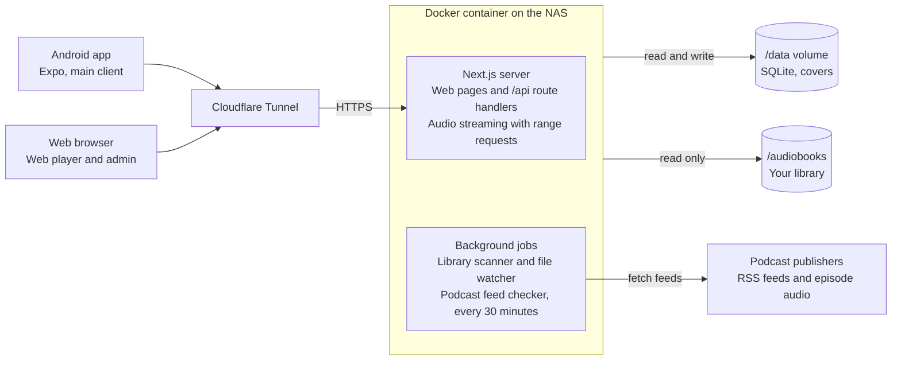

# Murmur — Project Spec

Oct 18, 2026 · @Garrett · Live version: https://claude.ai/code/artifact/2a76aaf4-ac07-43a5-b6a4-838d4d667177

## Overview

Murmur (working name) is a self-hosted server and Android app for listening to my own audiobooks and subscribing to podcasts by RSS, replacing Audiobookshelf. It runs as one Docker container on the NAS, managed in Portainer and served through Cloudflare.

Audiobookshelf did the job but was buggy and hard to maintain. This project trades breadth for reliability: fewer features, each one solid.

**Principles**

- **Phone first.** The Android app is the main way I listen; the web player is secondary.
- **One container, one volume of state.** No separate database, cache or worker containers. Optional add-ons (ad detection) run beside it, and Murmur works the same without them.
- **Files are the source of truth.** Folder names and embedded tags decide metadata; nothing is scraped from the internet in v1.
- **Boring to run.** Pinned versions, updates are a Portainer redeploy, backups are copying one folder.
- **One language.** TypeScript across server, web and app.

## Features (v1)

v1 covers listening to audiobooks and podcasts on the phone with progress synced to the server; everything else waits.

**Audiobooks**

- Library grid with covers, plus sort and filter by author, series, recently added and in progress
- Book page: cover, author, narrator, series and position, description, duration, chapter list
- Single-file `.m4b` and multi-file MP3 books, played as one continuous timeline
- Automatic rescan when files are added, moved or removed on the NAS
- One or more library folders, managed by the admin in Settings (seeded from `LIBRARY_DIR` on first start), each checked before it's saved
- Mark finished, reset progress

**Podcasts**

- Find podcasts by name (Apple's public podcast search, no API key needed) or paste an RSS feed URL; OPML import and export
- Server checks feeds on a schedule (default every 30 minutes, and once at startup) and lists new episodes
- Episodes stream through the server, which keeps the newest episodes of each followed show on disk and fetches others when first played (see Podcast episode cache and ad detection); the phone can download an episode on request.
- Up Next queue, and played, unplayed and archived states per episode

**Player**

- Mini player above the tabs, expanding to a full-screen player
- Skip back and forward (configurable, defaults 10 s and 30 s), chapter skip
- Playback speed 0.5× to 3×, remembered per book and per show
- Sleep timer: minutes or end of chapter
- Lock screen, notification, Bluetooth and headphone controls

**Sync and offline**

- Listening position saved to the server every few seconds and on pause
- Resume on any device where I left off
- Download books and episodes to the phone; offline progress syncs when back online

**Accounts**

- Multiple users, each with their own progress, subscriptions and queue
- One admin who manages users and library settings
- Login with username and password; the app keeps a long-lived token

## Tech stack

TypeScript everywhere: Next.js for the server and web UI, SQLite for storage, Expo for the Android app.

| Layer | Choice | Why |
| --- | --- | --- |
| Server and web UI | Next.js (App Router), self-hosted with `standalone` output | Familiar; route handlers serve the API, pages serve the web player |
| Database | SQLite via `better-sqlite3` + Drizzle ORM | A single file in `/data`; typed queries and migrations |
| Background jobs | Started from `instrumentation.ts` with `node-cron` and `chokidar` | Feed checks and library watching inside the same process |
| Audio metadata | `music-metadata` (pure JavaScript, no ffmpeg) | Reads tags, duration, chapters and embedded covers from m4b, mp3, flac and ogg/opus |
| RSS | `rss-parser` | Parses podcast feeds and iTunes tags |
| Auth | Session cookie for web, bearer token for the app; passwords hashed with argon2 | Simple, no external provider |
| Web styling | Tailwind CSS | Quick to build a Pocket Casts-like look |
| Android app | Expo (React Native) + Expo Router | React and TypeScript; shares types with the server |
| App playback | `expo-audio` | Background audio, lock-screen and notification controls, Bluetooth buttons; maintained with the Expo SDK |
| App downloads | `expo-file-system` | Offline books and episodes |
| App data | TanStack Query persisted to `expo-sqlite` key-value storage | Cached lists that open offline, offline progress queue |
| Shared code | `packages/shared`: API types and Zod schemas | One definition used by server, web and app |
| Repo | pnpm workspace monorepo | `apps/server`, `apps/mobile`, `packages/shared` |

All dependency versions are pinned; upgrades happen deliberately, not on every rebuild.

## Architecture

Everything runs in one Next.js process: the web pages, the JSON API the app calls, audio streaming and the background jobs.



The phone and browser reach the server only through the Cloudflare Tunnel. Podcast episodes are served from the server's episode cache, falling back to relaying the publisher's audio with range requests; downloads for offline listening happen only on the phone. The optional ad detection add-on runs as a second container (see Podcast episode cache and ad detection).

**Data model** (SQLite)

| Table | Holds |
| --- | --- |
| `users` | Username, password hash, admin flag |
| `sessions` | Web sessions and app tokens |
| `library_folders` | The folders the library is read from |
| `books` | Title, author, narrator, series, position, description, duration, cover path, library folder and path inside it, file hash |
| `book_files` | Each audio file in a book: path, order, duration, start offset |
| `chapters` | Title, start and end time per book |
| `podcasts` | Feed URL, title, author, artwork, last checked |
| `episodes` | GUID, title, publish date, duration, audio URL |
| `progress` | Per user and item: position, finished flag, last updated, speed |
| `queue` | Per user: ordered Up Next items |
| `episode_files`, `episode_ads`, `ad_scans` | The episode cache and ad times (see Podcast episode cache and ad detection) |

**API** (all under `/api`, JSON, token or cookie auth)

| Area | Endpoints |
| --- | --- |
| Auth | `POST /auth/setup` (first run only), `POST /auth/login`, `POST /auth/logout`, `GET /me` |
| Library | `GET /books`, `GET /books/:id`, `GET /books/:id/cover`, `POST /library/scan` |
| Book editing (admin) | `GET /books/:id/edit`, `PUT /books/:id/details`, `PUT /books/:id/chapters`, `POST/DELETE /books/:id/cover`, `POST /books/:id/rescan`, `GET/POST/DELETE /books/:id/match` |
| Streaming | `GET /stream/book/:id/:fileIndex`, `GET /stream/episode/:id` (range requests) |
| Podcasts | `GET/POST /podcasts`, `GET /podcasts/search?q=` (directory search, marks podcasts you follow), `GET /podcasts/preview?feedUrl=` (reads a feed without subscribing), `DELETE /podcasts/:id`, `GET /podcasts/:id/episodes`, `POST /podcasts/:id/refresh`, OPML import and export |
| Progress | `GET /progress?since=`, `PUT /progress` (batched, newest update wins) |
| Queue | `GET /queue`, `PUT /queue` |
| Admin | `GET/POST/DELETE /users`, `GET/PUT /library/folders`, `POST /library/folders/check`, `GET /library/browse?path=` |
| Episode cache and ads | `GET /episodes/:id/ads`; admin: `GET/PUT /server/cache`, `POST /server/ads/retry` |
| Add-on (shared secret) | `POST /addon/ads/next`, `POST /addon/ads/:fileId`, `POST /addon/status` |

Conflicts in progress sync resolve to the most recent update by timestamp, so listening offline on the phone and then online in the browser keeps the newer position.

## Performance and reliability

The app is small, so the bar is high: every screen opens instantly, playback starts in about a second, and nothing breaks without someone touching it.

**Targets** (measured on the NAS with a 1,000-book library)

| Measure | Target |
| --- | --- |
| Server cold start to ready | under 3 s |
| Library list API, p95 | under 50 ms |
| Playback start, LAN / through Cloudflare | under 1 s / under 2 s |
| Full rescan, nothing changed | under 5 s |
| Memory at idle | under 200 MB |
| Docker image size | under 350 MB (the Node binary is about 125 MB of that) |
| App: library screen open, cached | under 300 ms, works offline |

**Server speed**

- SQLite in WAL mode with indexes on every lookup column; the library list is one query, not one per book.
- No transcoding: audio is streamed byte for byte with range requests, so playback costs almost no CPU.
- Covers are resized once at scan time (200 px and 600 px WebP) and served with a content hash in the URL and a one-year immutable cache header; Cloudflare and the phone cache them for good.
- JSON responses carry ETags, so unchanged data returns `304 Not Modified` with no body.
- Incremental scans: only files whose size or modified time changed are probed again. At most 2 files are read at a time so a big import doesn't swamp the NAS.
- Progress updates are tiny writes, debounced on the client to one every 10 s plus on pause.

**App speed**

- Library, podcasts and progress are cached on the phone, so screens draw from local data first and refresh in the background.
- Long lists use virtualized rendering (FlashList); covers load through `expo-image` with disk caching.
- Progress is written on the phone first and synced after, so a flaky connection never stalls the player.

**"Just works" safeguards**

- **Never lose progress.** Progress rows are never deleted when a book disappears; if the book comes back, so does your place.
- **Survive a NAS hiccup.** If a library folder is empty or unreachable, the scanner leaves its books alone and reports the problem in Settings; the other folders still scan. Missing books are marked missing and only hidden after 7 days. Removing a folder in Settings removes its books on the next scan, unless they turn up in another folder, which keeps their progress.
- **Safe updates.** Migrations run in a transaction after copying the database to `/data/backups`; a failed migration rolls back and the old image still works.
- **Nightly backup** of the database to `/data/backups`, keeping the last 7.
- **Health check.** `/api/health` reports database, library mount and job status, and Portainer shows it. A fatal error exits the process so the restart policy brings it back.
- **Clean shutdown.** On stop, pending writes are flushed and the database closed, so a redeploy can't corrupt it.
- **Podcast feeds are isolated.** Each check has a 15 s timeout, retries with backoff, and uses conditional requests; one broken feed never blocks the rest.
- **Bounded logs**: one JSON line per event to stdout, rotated by Docker's log settings in the stack (5 files of 10 MB).
- **Few dependencies,** all pinned. Fewer moving parts means fewer surprise breakages.
- **Tested before release.** A small set of unit tests covers the rules that matter most (folder and title parsing, file ordering, chapter timing, range requests, match scoring); no integration tests. CI must pass before an image is published.

## Library scanning rules

The scanner follows the Audiobookshelf folder layout already on the NAS, so no files need to move.

**Accepted layouts** (relative to the mounted `/audiobooks` folder)

```
Author/Title/book.m4b
Author/Title/01.mp3, 02.mp3, ...
Author/Series/Title/...
Author/Series/Book 3 - Title/...
```

**Rules**

1. A **book** is a folder that directly contains audio files (`.m4b`, `.m4a`, `.mp3`, `.flac`, `.ogg`, `.opus`).
2. One `.m4b` file = one book; its embedded chapters are used.
3. Several audio files = one multi-file book, ordered by track tag, then disc tag, then natural filename sort. Each file becomes a chapter unless embedded chapters exist.
4. Path depth 2 (`Author/Title`) = no series; depth 3 (`Author/Series/Title`) = series name from the middle folder.
5. A leading number in the title folder (`Book 3 - Title`, `03. Title`) sets the series position.
6. Cover art: `cover.jpg` or `cover.png` in the folder, then the first image file, then embedded art.
7. Optional `desc.txt` (description) and `reader.txt` (narrator) are read, matching Audiobookshelf.

**Metadata priority:** embedded tags (title, author, narrator, year, description) win over folder names, except that folder names always decide author and series grouping, so one mis-tagged file can't split a series.

**Identity:** a book is keyed by its folder path plus a hash of its file list, so progress survives a rescan and renaming a file inside a book doesn't lose it. Moving a book folder is detected by matching the file hash.

**Scans:** a full scan on startup and on demand from the admin page; between scans, a file watcher picks up changes after 30 s of quiet.

## Metadata

Metadata comes from your files first; an optional Match button fills gaps from online sources, and only when you confirm it.

**Layer 1: local, always on** (done by the scanner)

| Field | Source, in priority order |
| --- | --- |
| Title | Embedded title tag, then the folder name minus any series number |
| Author | Author folder (decides grouping); embedded artist tag shown if it differs |
| Narrator | `reader.txt`, then the composer or narrator tag |
| Series and position | Series folder and the leading number in the title folder, then the grouping tag |
| Description | `desc.txt`, then the comment or description tag |
| Year | Date tag |
| Duration and chapters | `music-metadata` on the audio files (constant-bitrate MP3 lengths from size and bitrate) |
| Cover | `cover.jpg` or `cover.png`, then any image in the folder, then embedded art |

**Layer 2: online match, on demand** (built in phase 3, admin only)

1. From a book page or a library card's options menu, open **Match metadata**. The server searches Audible's catalog by title and author, with Google Books as a fallback.
2. You pick the right result from a list with covers.
3. The match fills only empty or poor fields (missing cover, description, narrator, series, a better chapter list from Audnexus). Fields you don't tick are left alone, and **Undo match** in the book menu returns to the file metadata.
4. Matched data is stored in the database as an override; your files are never modified, and a rescan never undoes a match.

Nothing is ever applied without your confirmation: wrong guesses were one of Audiobookshelf's most annoying bugs. The Audible and Audnexus lookups are unofficial APIs that Audiobookshelf also relies on, so if they break, matching degrades and everything else keeps working.

**How matching stays consistent**

Audiobookshelf mostly searched by the raw folder name and trusted the first result. Murmur matches deterministically: the same book always gets the same answer, and a weak answer is shown as weak instead of applied.

1. **IDs first.** If a file's tags or the folder name carry an Audible ASIN or an ISBN (Libation and OpenAudible downloads usually do), look it up directly. No searching, no guessing.
2. **Clean the query.** Strip series numbers, "Unabridged", years, bracketed tags and narrator names from the title; normalize accents, punctuation and author name forms ("J.R.R. Tolkien" equals "J. R. R. Tolkien").
3. **Gather candidates** from Audible (region set in settings, default US), then Google Books only when Audible has nothing scoring 70 or more. Provider responses are cached in the database for 30 days, and a stale cached answer is used if a provider is down.
4. **Score every candidate** on the same weighted checks:

| Signal | Weight | Why it matters |
| --- | --- | --- |
| Duration within 2% of the local files | High | Tells unabridged from abridged and dramatized editions; this was missing in Audiobookshelf |
| Author name match | High | Stops same-title books by other authors |
| Title similarity after cleaning | High | Core match |
| Narrator match | Medium | Separates re-recordings |
| Series name and position match | Medium | Picks the right book in a series |
| Language | Low | Avoids translated editions |

5. **Act on the score.** 90 or above: pre-selected as the suggestion. 70 to 89: candidates listed, nothing pre-selected. Below 70: "No confident match", with a manual search box.
6. **Review before apply.** A side-by-side view shows current and proposed values per field, with checkboxes. Empty or poorer fields are ticked by default; titles and authors never are. (Bulk matching, a review queue of confident suggestions approved in one pass, is a later idea.)
7. **Safe merge rules.** A new cover is only suggested when it is larger than the current one. Online chapter lists are only applied when their total length matches the files within 1%, so chapter marks can't drift.
8. **Remember the result.** The chosen ASIN is stored, so later refreshes are exact lookups.
9. **Tested where it matters.** Unit tests pin the scoring rules: name forms, title cleaning, the abridged-edition penalty, the author cap, the no-length cap and ASIN trust.

**Layer 3: editing by hand** (admin only, web)

Every book card in the library has an options menu (Play, Add to Up Next, Mark as finished, and for admins Edit details, Change cover, Match metadata, Rescan files), so books can be fixed without opening each one. The edit dialog has five tabs:

| Tab | What it does |
| --- | --- |
| Details | Title, author, narrator, series and book number, year, description. A changed field is marked Edited, shows what the files say, and can be reset |
| Cover | Upload an image (drop or pick), use an image link, or pick a cover from the online results; go back to the files' cover at any time |
| Chapters | Rename chapters, change start times, add or remove them; or go back to the files' chapters |
| Match | The online match above, inside the dialog |
| Files | The book's folder and files with length, size and bitrate; rescan this book; undo every edit and match |

Edits are stored in the same override row as a match, so a rescan keeps them and the files are never touched. An admin-only **Needs attention** view in the library lists books with no cover, no author or missing files, plus unmatched books on request. Bulk editing several books at once is a later idea.

**Podcasts:** show and episode titles, artwork, descriptions and durations come from the RSS feed itself; no lookup needed.

## Android app

Mockups: `docs/mockups/` (live canvas: https://claude.ai/artifact/CLDX4isFfLSeaufpfAFUG7).

The app copies Pocket Casts' layout: bottom tabs, a persistent mini player, and a full-screen player tinted from the cover art.

**Screens**

| Tab or screen | Contents |
| --- | --- |
| Library | Cover grid or list of audiobooks; Continue Listening row on top; filter by author, series, status, downloaded |
| Podcasts | Grid of subscribed shows with unplayed counts; add a show by RSS URL; filter to downloaded episodes |
| Up Next | The queue across books and episodes, drag to reorder |
| Profile | Server URL, account, playback defaults, storage used by downloads, listening stats |
| Book or show page | Header with cover and colour band, description, chapters or episode list, download and play buttons |
| Full-screen player | Large cover, chapter name, scrubber for chapter and whole book, speed, sleep timer, skip buttons, chapter list sheet |

There is no separate Downloads tab: downloads are managed from each book or show page, with a Downloaded filter in Library and Podcasts.

**Look and feel:** dark theme by default with a light option; periwinkle accent (#8E9BFF on dark, #4F5BD5 on light); the player background takes its colour from the cover; large touch targets; the mini player swipes up into the full player.

**Playback:** `expo-audio` runs as a media session service so audio keeps playing with the screen off, with lock-screen and notification controls. One player is shared by the whole app; a multi-file book plays file by file on one continuous timeline. Streams use the server's range-request endpoint with the app's token, and downloaded files play from local storage. Limits of `expo-audio` on Android: speed goes up to 2×, and the lock-screen and headset skip buttons always move 10 seconds (the in-app skip buttons use the lengths set in Profile).

**Offline:** lists and opened pages are cached on the phone, so the app opens and downloaded items play without a connection. Progress is written to a local outbox first and sent to the server when it's reachable.

**First run:** enter the server URL (the Cloudflare hostname), then username and password; the app stores a token and never asks again until it's revoked.

**Distribution:** builds with EAS Build into an APK installed directly, no Play Store. JavaScript-only fixes ship as over-the-air updates through EAS Update without reinstalling.

**Later, not v1:** Android Auto, home screen widget, Chromecast.

## Podcast episode cache and ad detection

The server keeps recent episodes of every followed show on disk, so everyone streams the same copy. An optional second container finds the ads in those copies, and the players can mark or skip them. Ad detection is decoration: if any part of it is missing or broken, podcasts play exactly as before, just without ad marks.

### Episode cache (part of Murmur)

Dynamically inserted ads differ on every download, so ad times only hold for one copy of the file. The cache makes that one copy the one everyone hears. It is useful without the add-on, since episodes start faster and don't depend on the publisher's server while playing.

- **What gets downloaded.** After each feed check, the newest 3 episodes of every show anyone follows. Admins change the 3 in Settings ("Episodes kept ready per show", 0 turns prefetching off). Downloads are per episode, so a show five people follow is fetched once.
- **What doesn't.** Episodes every follower has finished or archived, and shows nobody follows.
- **One download at a time,** with a 60 s stall timeout and up to 3 tries with backoff. An episode that still fails is streamed by relaying, as before.
- **On demand.** Playing an episode that isn't cached starts its download, and playback reads the growing file. A range that isn't on disk yet waits for the download (which runs far faster than playback) rather than being relayed, because a relayed range could come from a different copy with different ads. If the download fails, the stream falls back to relaying the whole episode, without ad marks.
- **Serving.** `/api/stream/episode/:id` serves the cached copy when there is one. Phone downloads come from the same file, so their ad times match.
- **Storage.** Episodes live in their own mount, `/cache`, kept out of `/data` so backups stay small. `EPISODE_CACHE_MAX_GB` (default 20) caps it.
- **Eviction** when over the cap: never an episode that is in anyone's Up Next, in progress, or among a show's newest 3. Episodes everyone finished go first, then the least recently played. An episode's ad times are deleted with its file.
- **Failure.** If `/cache` is missing, full or unwritable, Murmur relays streams as before and shows the problem in Settings. `/api/health` reports it without failing, so Portainer doesn't restart the container over it.

### Ad detection add-on (optional container)

A second service in the same stack, `murmur-adscan`. Left out of the stack, Murmur behaves exactly as it does without it.

**How it works**

1. **Take the next episode.** The add-on asks Murmur for work (`POST /api/addon/ads/next`) and gets an episode, its file path under `/cache` and its length. The job is leased for 30 minutes, so a job from a crashed add-on returns to the queue. Murmur picks in this order: something being played right now, then episodes in anyone's Up Next, then prefetched episodes, newest first.
2. **Transcribe.** The cached file is read read-only, 30 minutes at a time. Each piece goes to Groq (hosted Whisper large-v3-turbo, as a 32 kbps mp3). When Groq is not set up, is down, or its audio allowance would mean waiting more than 15 minutes, that piece is transcribed on the server by Vosk (small English model) instead. Each piece's transcript is saved to the add-on's own `/state` volume, so a restart or a Gemini outage never redoes finished pieces.
3. **Find the ads.** Each piece goes to Gemini as text (short timed lines) as soon as it is transcribed, running 2 minutes into the next piece so an ad break on a cut is seen whole. Copies of an ad found in two pieces are merged.
4. **Check the answer.** Spans with the end before the start, outside the episode, or longer than 5 minutes are dropped, and spans running past the end are cut to it.
5. **Report.** Spans are posted per piece (`POST /api/addon/ads/:episodeId`), so the first marks appear minutes after a scan starts, not after the whole episode.

Each span has a start, an end, a kind (`inserted`, `host_read` or `promo`), the advertiser if named, and its first words.

**Why this approach** (from a benchmark on a 70-minute episode with 20 ads)

| Approach | Result | Cost per hour of audio |
| --- | --- | --- |
| Groq Whisper transcript to Gemini Flash-Lite as text | All 20 ads, with far cleaner text than Vosk (names, advertisers, promo codes) | Free within Groq's allowance, plus about 1 cent of Gemini paid |
| Vosk transcript to Gemini 3.5 Flash-Lite as text | All 20 ads, edges within about a second, whole or in 30-minute pieces | About 23k tokens, about 1 cent paid |
| Parakeet TDT 0.6B on the server | Transcripts as good as Groq's | Free, but about 1.4 GB of memory: too much beside Plex and the rest of the server |
| Whole audio to Gemini | Missed most ads in one run, invented ads past the end of the episode | About 90k tokens, about 3 cents |
| Keyword rules on a transcript | Missed any ad without a stock phrase | Free |
| Whisper on the AS5304T (no AVX) | Tiny 0.4x, base 0.2x real time: can't keep up | Free |

Groq transcribes 30 minutes in about 15 to 25 seconds. Its free tier allows about 2 hours of audio per hour and 8 per day; the add-on paces itself under that, so a big backlog spreads over the day, with Vosk covering what doesn't fit. Vosk runs at about 5x real time on the AS5304T (about 12 minutes per hour of audio, about 500 MB of memory). At about 23k tokens per hour, normal use fits Gemini's free tier.

**Settings** (environment variables, add-on only)

| Variable | Default | |
| --- | --- | --- |
| `MURMUR_URL` | `http://murmur:3000` | Murmur inside the stack (its container port) |
| `ADDON_SECRET` | | The same value as Murmur's. On Murmur, this one variable is the on switch: without it there are no add-on endpoints, no scans and no ad settings |
| `GEMINI_API_KEY` | | Required. Lives only here, never in Murmur |
| `GEMINI_MODEL` | `gemini-flash-lite-latest` | Google's alias for its newest Flash-Lite, so retirements don't break the add-on. When it moves to a new model, prices and free-tier limits can change with it. Set a fixed model (for example `gemini-3.5-flash-lite`) to pin one |
| `GEMINI_RPM` / `GEMINI_TPM` / `GEMINI_RPD` | 10 / 200,000 / 400 | The add-on paces itself under these; defaults sit below the free tier's limits |
| `GROQ_API_KEY` | | Optional, recommended. Without it every piece uses Vosk. Lives only here |
| `GROQ_MODEL` | `whisper-large-v3-turbo` | |
| `GROQ_AUDIO_PER_HOUR` / `GROQ_AUDIO_PER_DAY` | 7,200 / 28,800 | Seconds of audio; Groq's free-tier limits. Raise them on a paid plan |

The stack also gives the add-on a CPU limit, and it scans one episode at a time.

**Failure handling.** Nothing in playback, streaming or the cache ever waits on the add-on.

| Failure | What happens |
| --- | --- |
| Groq down, its limit reached, its allowance used up, or its key refused | That piece uses Vosk. Settings shows "Transcribing with Vosk" with the reason, and until when if known. A refused key is tried again hourly |
| Gemini rate limit (per minute), 500, 503, network error | Retry with backoff and jitter, using the delay Gemini suggests, up to 5 times; then the piece goes back in the queue for later |
| Gemini daily limit | Gemini calls pause until it resets (midnight Pacific). Transcription carries on, so the backlog is ready to send. Status: "Paused until 12:00 AM PT" |
| Bad key, billing problem, model retired (400, 401, 403, 404) | Gemini calls stop and the status shows the error. Checked again hourly and on restart |
| Unreadable or nonsense answer | That piece is retried once, then marked failed; one bad span never drops the others |
| Episode file deleted mid-scan | The job is dropped |
| Add-on crashes | Its lease runs out and the job returns to the queue; saved transcripts mean it resumes where it stopped |
| Add-on stopped or missing | Episodes simply have no marks. Settings shows "Not connected" after 15 minutes without contact |
| Murmur unreachable from the add-on | The add-on keeps its results and posts them when Murmur is back |
| Episode re-downloaded | Ad times belong to one cached file; a new file drops the old times and is scanned again |

Each episode has a scan status: queued, scanning, done or failed, with the attempt count and last error. After 3 failed attempts an episode stops being retried until an admin presses Retry.

### Player and settings

- **Marks.** Ad spans are drawn on the seek bar in the web player and the app.
- **Modes,** set per device (each browser and each phone keeps its own), with an optional per-show override on that device. For example, Auto-skip on the phone in the car and Show on the desktop.
  - **Off:** no marks.
  - **Show** (default): marks, plus a Skip ad button while an ad plays.
  - **Auto-skip:** playback jumps to the end of a span when it reaches the span's start, and a "Skipped ad" toast offers Undo for 5 seconds. Undo goes back to the start and doesn't skip that span again during this listen.
- **No surprise skips.** If playback starts or lands inside an ad (resuming, or seeking into it), that ad isn't skipped; the Skip ad button shows instead.
- **Offline.** Phone downloads store the ad spans with the episode, so marks and skipping work offline.
- **Skipping covers the whole break:** ads less than 3 seconds apart count as one break, for both Skip ad and Auto-skip ("Skipped 3 ads").
- **Fetching ads.** The player asks `GET /api/episodes/:id/ads` for the current episode and asks again every minute while its scan runs. Asking also marks the episode as playing, which moves its scan to the front. Without the add-on the answer is `enabled: false`, and the ad setting is hidden.
- **Fewer ads for Murmur.** Hosts that insert ads per download (Simplecast, for one) insert fewer for apps they don't recognise, and Murmur identifies itself honestly. Its copy can have fewer ads than the same episode in Pocket Casts.
- **Admin settings:** episodes kept ready per show, cache usage against its cap, and the add-on's status (connected or last seen, queue length, today's Gemini requests, paused or error), with Retry for failed episodes.

**Data model additions**

| Table | Holds |
| --- | --- |
| `episode_files` | Episode, path under `/cache`, size, status (downloading, ready, failed), attempts, downloaded at, last played at |
| `episode_ads` | Cached file, start, end, kind, advertiser, first words |
| `ad_scans` | Cached file, status, pieces done, attempts, last error, lease expiry |

## Deployment

Deploying is one Portainer stack with two volumes, reached through the existing Cloudflare Tunnel. See `docker-compose.yml` in the repo root for the current version.

| Mount | Purpose | Notes |
| --- | --- | --- |
| `/audiobooks` | The existing audiobook library (`LIBRARY_DIR`, the first library folder) | Read-only: the app never writes to or renames your files. Mount more folders and add them in Settings |
| `/data` | SQLite database and cover cache | The only thing to back up |
| `/cache` | Cached podcast episodes | Optional; without it episodes are relayed. Not worth backing up. The ad add-on mounts it read-only |

**Image:** a GitHub Actions workflow builds a multi-arch image (amd64 and arm64) and pushes it to GitHub Container Registry on each tagged release.

**Cloudflare:** point the tunnel's public hostname at `http://<nas-ip>:3333`. Streaming uses normal HTTP range requests, which work through the tunnel. Cloudflare Access can sit in front of the web UI, but the app needs a bypass rule for `/api/*` because it can't complete the Access login.

**Updates:** change the image tag in the stack and redeploy. Database migrations run automatically on startup, and a copy of the database is saved to `/data/backups` before each migration.

**First start:** the first account created becomes the admin; a full library scan runs automatically.

**Optional settings:** `AUDIBLE_REGION` (default `us`; also `uk`, `ca`, `au`, `de`, `fr`, `it`, `es`, `in`, `jp`) picks the Audible store Match searches. `EPISODE_CACHE_MAX_GB` (default 20) caps the episode cache. `ADDON_SECRET` turns on the add-on endpoints.

**Ad detection add-on:** an optional second service in the stack, `murmur-adscan`, with `/cache` mounted read-only, its own `/state` volume, a CPU limit, and the settings listed in Podcast episode cache and ad detection.

## Local development

Run `pnpm install` once, then `pnpm dev` and open http://localhost:3000. `apps/server/.env.development` points the database and covers at the repo's git-ignored `data/` folder and the library at `data/audiobooks`. Docker is only used for the production image: on Windows a bind-mounted source folder delivers no file-change events, so hot reload inside a container is unreliable.

## Non-goals and later ideas

v1 leaves out the features that made Audiobookshelf heavy; each can be added later if it earns its place.

**Not in v1**

- Automatic or bulk online metadata matching (matching is manual and confirmed)
- Transcoding or format conversion; files are served as they are
- Editing tags or moving files from the app
- Ebooks and comics
- iOS app (the web player works in Safari meanwhile)
- Plugins, themes, notification integrations
- Podcast search or directory; subscribe by URL only

**Ideas for later**

- Android Auto through a small native Media3 module
- Optional metadata matching for books with poor tags, shown as a suggestion to accept
- Bookmarks and clips with notes
- Listening stats and yearly recap
- Collections and shared family playlists
- Home screen widget and Chromecast

## Roadmap

The build runs in four phases, and each ends when it can take over a piece of Audiobookshelf's job.

| Phase | Scope | Done when |
| --- | --- | --- |
| 1. Server core | Library scanner, streaming and auth, progress sync, Docker image | A book plays from the NAS |
| 2. Podcasts | Subscribe by RSS URL, scheduled feed checks, streaming through the server, OPML import and export | Podcasts move off ABS |
| 3. Web player | Library and book pages, player and Up Next, podcast pages, admin and users | Daily use on desktop |
| 4. Android app | Tabs and mini player, background playback, offline downloads, offline progress sync | Audiobookshelf retired |
| 5. Episode cache | Prefetch the newest episodes per show, on-demand downloads with growing-file playback, cap and eviction, admin settings | Episodes play from the server's copy |
| 6. Ad detection | The `murmur-adscan` add-on, add-on endpoints, seek bar marks, Show and Auto-skip per device | Ads skipped on the phone |

Phase 1 included a bare web page for testing playback; phase 3 turned it into the real web player (library, book and show pages, full and mini player, Up Next, profile and admin, metadata Match, light and dark themes). No dates are set yet, and each phase ships as a tagged Docker image release.

## Open questions

- [ ] **Name.** Murmur for now, as a working name; not yet checked for clashes with existing apps.
- [ ] Which NAS (Synology, Unraid, TrueNAS, other) and CPU architecture? Sets the image build and volume paths.
- [ ] Is Cloudflare Access in front of Audiobookshelf today? Decides whether the app needs the `/api/*` bypass.
- [x] Import listening progress from Audiobookshelf? Decided: no, start fresh.
- [x] Auto-download podcasts on the server? First decided no; changed in October 2026 to yes, the newest 3 episodes of each followed show, so ad times can match one shared copy.
- [ ] Default skip intervals and playback speed.
