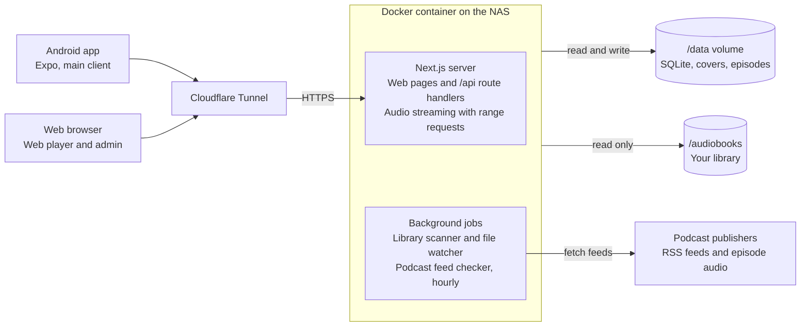

# Murmur — Project Spec

Oct 18, 2026 · @Garrett · Live version: https://claude.ai/code/artifact/2a76aaf4-ac07-43a5-b6a4-838d4d667177

## Overview

Murmur (working name) is a self-hosted server and Android app for listening to my own audiobooks and subscribing to podcasts by RSS, replacing Audiobookshelf. It runs as one Docker container on the NAS, managed in Portainer and served through Cloudflare.

Audiobookshelf did the job but was buggy and hard to maintain. This project trades breadth for reliability: fewer features, each one solid.

**Principles**

- **Phone first.** The Android app is the main way I listen; the web player is secondary.
- **One container, one volume of state.** No separate database, cache or worker containers.
- **Files are the source of truth.** Folder names and embedded tags decide metadata; nothing is scraped from the internet in v1.
- **Boring to run.** Pinned versions, updates are a Portainer redeploy, backups are copying one folder.
- **One language.** TypeScript across server, web and app.

## Features (v1)

v1 covers listening to audiobooks and podcasts on the phone with progress synced to the server; everything else waits.

**Audiobooks**

- Library grid with covers, plus sort and filter by author, series, recently added and in progress
- Book page: cover, author, narrator, series and position, description, duration, chapter list
- Single-file `.m4b` and multi-file MP3 books, played as one continuous timeline
- Automatic rescan when files are added, moved or removed on the NAS
- Mark finished, reset progress

**Podcasts**

- Subscribe by pasting an RSS feed URL; OPML import and export
- Server checks feeds on a schedule (default hourly) and lists new episodes
- Episodes stream from the publisher by default; per-show option to auto-download to the NAS, keeping the last N
- Up Next queue, and played, unplayed and archived states per episode

**Player**

- Mini player above the tabs, expanding to a full-screen player
- Skip back and forward (configurable, defaults 10 s and 30 s), chapter skip
- Playback speed 0.5× to 3×, remembered per book and per show
- Sleep timer: minutes or end of chapter
- Lock screen, notification, Bluetooth and headphone controls

**Sync and offline**

- Listening position saved to the server every few seconds and on pause
- Resume on any device where I left off
- Download books and episodes to the phone; offline progress syncs when back online

**Accounts**

- Multiple users, each with their own progress, subscriptions and queue
- One admin who manages users and library settings
- Login with username and password; the app keeps a long-lived token

## Tech stack

TypeScript everywhere: Next.js for the server and web UI, SQLite for storage, Expo for the Android app.

| Layer | Choice | Why |
| --- | --- | --- |
| Server and web UI | Next.js (App Router), self-hosted with `standalone` output | Familiar; route handlers serve the API, pages serve the web player |
| Database | SQLite via `better-sqlite3` + Drizzle ORM | A single file in `/data`; typed queries and migrations |
| Background jobs | Started from `instrumentation.ts` with `node-cron` and `chokidar` | Feed checks and library watching inside the same process |
| Audio metadata | `ffprobe` (bundled in the image) + `music-metadata` | Reads tags, duration and chapters from m4b and mp3 |
| RSS | `rss-parser` | Parses podcast feeds and iTunes tags |
| Auth | Session cookie for web, bearer token for the app; passwords hashed with argon2 | Simple, no external provider |
| Web styling | Tailwind CSS | Quick to build a Pocket Casts-like look |
| Android app | Expo (React Native) + Expo Router | React and TypeScript; shares types with the server |
| App playback | `react-native-track-player` | Background audio, lock-screen and notification controls, Bluetooth buttons |
| App downloads | `expo-file-system` | Offline books and episodes |
| App data | TanStack Query + local SQLite (`expo-sqlite`) | Caching, offline progress queue |
| Shared code | `packages/shared`: API types and Zod schemas | One definition used by server, web and app |
| Repo | pnpm workspace monorepo | `apps/server`, `apps/mobile`, `packages/shared` |

All dependency versions are pinned; upgrades happen deliberately, not on every rebuild.

## Architecture

Everything runs in one Next.js process: the web pages, the JSON API the app calls, audio streaming and the background jobs.



The phone and browser reach the server only through the Cloudflare Tunnel. Podcast episodes that aren't auto-downloaded stream straight from the publisher to the phone.

**Data model** (SQLite)

| Table | Holds |
| --- | --- |
| `users` | Username, password hash, admin flag |
| `sessions` | Web sessions and app tokens |
| `books` | Title, author, narrator, series, position, description, duration, cover path, folder path, file hash |
| `book_files` | Each audio file in a book: path, order, duration, start offset |
| `chapters` | Title, start and end time per book |
| `podcasts` | Feed URL, title, author, artwork, auto-download setting, last checked |
| `episodes` | GUID, title, publish date, duration, audio URL, local path if downloaded |
| `progress` | Per user and item: position, finished flag, last updated, speed |
| `queue` | Per user: ordered Up Next items |

**API** (all under `/api`, JSON, token or cookie auth)

| Area | Endpoints |
| --- | --- |
| Auth | `POST /auth/setup` (first run only), `POST /auth/login`, `POST /auth/logout`, `GET /me` |
| Library | `GET /books`, `GET /books/:id`, `GET /books/:id/cover`, `POST /library/scan` |
| Streaming | `GET /stream/book/:id/:fileIndex`, `GET /stream/episode/:id` (range requests) |
| Podcasts | `GET/POST /podcasts`, `DELETE /podcasts/:id`, `GET /podcasts/:id/episodes`, `POST /podcasts/:id/refresh`, OPML import and export |
| Progress | `GET /progress?since=`, `PUT /progress` (batched, newest update wins) |
| Queue | `GET /queue`, `PUT /queue` |
| Admin | `GET/POST/DELETE /users` |

Conflicts in progress sync resolve to the most recent update by timestamp, so listening offline on the phone and then online in the browser keeps the newer position.

## Performance and reliability

The app is small, so the bar is high: every screen opens instantly, playback starts in about a second, and nothing breaks without someone touching it.

**Targets** (measured on the NAS with a 1,000-book library)

| Measure | Target |
| --- | --- |
| Server cold start to ready | under 3 s |
| Library list API, p95 | under 50 ms |
| Playback start, LAN / through Cloudflare | under 1 s / under 2 s |
| Full rescan, nothing changed | under 5 s |
| Memory at idle | under 200 MB |
| Docker image size | under 450 MB (Node is 175 MB and ffmpeg 135 MB of that) |
| App: library screen open, cached | under 300 ms, works offline |

**Server speed**

- SQLite in WAL mode with indexes on every lookup column; the library list is one query, not one per book.
- No transcoding: audio is streamed byte for byte with range requests, so playback costs almost no CPU.
- Covers are resized once at scan time (200 px and 600 px WebP) and served with a content hash in the URL and a one-year immutable cache header; Cloudflare and the phone cache them for good.
- JSON responses carry ETags, so unchanged data returns `304 Not Modified` with no body.
- Incremental scans: only files whose size or modified time changed are probed again. `ffprobe` runs at most 2 at a time so a big import doesn't swamp the NAS.
- Progress updates are tiny writes, debounced on the client to one every 10 s plus on pause.

**App speed**

- Library, podcasts and progress are cached on the phone, so screens draw from local data first and refresh in the background.
- Long lists use virtualized rendering (FlashList); covers load through `expo-image` with disk caching.
- Progress is written on the phone first and synced after, so a flaky connection never stalls the player.

**"Just works" safeguards**

- **Never lose progress.** Progress rows are never deleted when a book disappears; if the book comes back, so does your place.
- **Survive a NAS hiccup.** If the library folder is empty or unreachable, the scanner stops instead of removing books. Missing books are marked missing and only hidden after 7 days.
- **Safe updates.** Migrations run in a transaction after copying the database to `/data/backups`; a failed migration rolls back and the old image still works.
- **Nightly backup** of the database to `/data/backups`, keeping the last 7.
- **Health check.** `/api/health` reports database, library mount and job status, and Portainer shows it. A fatal error exits the process so the restart policy brings it back.
- **Clean shutdown.** On stop, pending writes are flushed and the database closed, so a redeploy can't corrupt it.
- **Podcast feeds are isolated.** Each check has a 15 s timeout, retries with backoff, and uses conditional requests; one broken feed never blocks the rest.
- **Bounded logs**: one JSON line per event to stdout, rotated by Docker's log settings in the stack (5 files of 10 MB).
- **Few dependencies,** all pinned. Fewer moving parts means fewer surprise breakages.
- **Tested before release.** A small set of unit tests covers the rules that matter most (folder and title parsing, file ordering, chapter timing, range requests, match scoring); no integration tests. CI must pass before an image is published.

## Library scanning rules

The scanner follows the Audiobookshelf folder layout already on the NAS, so no files need to move.

**Accepted layouts** (relative to the mounted `/audiobooks` folder)

```
Author/Title/book.m4b
Author/Title/01.mp3, 02.mp3, ...
Author/Series/Title/...
Author/Series/Book 3 - Title/...
```

**Rules**

1. A **book** is a folder that directly contains audio files (`.m4b`, `.m4a`, `.mp3`, `.flac`, `.ogg`, `.opus`).
2. One `.m4b` file = one book; its embedded chapters are used.
3. Several audio files = one multi-file book, ordered by track tag, then disc tag, then natural filename sort. Each file becomes a chapter unless embedded chapters exist.
4. Path depth 2 (`Author/Title`) = no series; depth 3 (`Author/Series/Title`) = series name from the middle folder.
5. A leading number in the title folder (`Book 3 - Title`, `03. Title`) sets the series position.
6. Cover art: `cover.jpg` or `cover.png` in the folder, then the first image file, then embedded art.
7. Optional `desc.txt` (description) and `reader.txt` (narrator) are read, matching Audiobookshelf.

**Metadata priority:** embedded tags (title, author, narrator, year, description) win over folder names, except that folder names always decide author and series grouping, so one mis-tagged file can't split a series.

**Identity:** a book is keyed by its folder path plus a hash of its file list, so progress survives a rescan and renaming a file inside a book doesn't lose it. Moving a book folder is detected by matching the file hash.

**Scans:** a full scan on startup and on demand from the admin page; between scans, a file watcher picks up changes after 30 s of quiet.

## Metadata

Metadata comes from your files first; an optional Match button fills gaps from online sources, and only when you confirm it.

**Layer 1: local, always on** (done by the scanner)

| Field | Source, in priority order |
| --- | --- |
| Title | Embedded title tag, then the folder name minus any series number |
| Author | Author folder (decides grouping); embedded artist tag shown if it differs |
| Narrator | `reader.txt`, then the composer or narrator tag |
| Series and position | Series folder and the leading number in the title folder, then the grouping tag |
| Description | `desc.txt`, then the comment or description tag |
| Year | Date tag |
| Duration and chapters | `ffprobe` on the audio files |
| Cover | `cover.jpg` or `cover.png`, then any image in the folder, then embedded art |

**Layer 2: online match, on demand** (built in phase 3, admin only)

1. On a book page, tap **Match**. The server searches Audible's catalog by title and author, with Google Books as a fallback.
2. You pick the right result from a list with covers.
3. The match fills only empty or poor fields (missing cover, description, narrator, series, a better chapter list from Audnexus). Fields you don't tick are left alone, and **Undo match** in the book menu returns to the file metadata.
4. Matched data is stored in the database as an override; your files are never modified, and a rescan never undoes a match.

Nothing is ever applied without your confirmation: wrong guesses were one of Audiobookshelf's most annoying bugs. The Audible and Audnexus lookups are unofficial APIs that Audiobookshelf also relies on, so if they break, matching degrades and everything else keeps working.

**How matching stays consistent**

Audiobookshelf mostly searched by the raw folder name and trusted the first result. Murmur matches deterministically: the same book always gets the same answer, and a weak answer is shown as weak instead of applied.

1. **IDs first.** If a file's tags or the folder name carry an Audible ASIN or an ISBN (Libation and OpenAudible downloads usually do), look it up directly. No searching, no guessing.
2. **Clean the query.** Strip series numbers, "Unabridged", years, bracketed tags and narrator names from the title; normalize accents, punctuation and author name forms ("J.R.R. Tolkien" equals "J. R. R. Tolkien").
3. **Gather candidates** from Audible (region set in settings, default US), then Google Books only when Audible has nothing scoring 70 or more. Provider responses are cached in the database for 30 days, and a stale cached answer is used if a provider is down.
4. **Score every candidate** on the same weighted checks:

| Signal | Weight | Why it matters |
| --- | --- | --- |
| Duration within 2% of the local files | High | Tells unabridged from abridged and dramatized editions; this was missing in Audiobookshelf |
| Author name match | High | Stops same-title books by other authors |
| Title similarity after cleaning | High | Core match |
| Narrator match | Medium | Separates re-recordings |
| Series name and position match | Medium | Picks the right book in a series |
| Language | Low | Avoids translated editions |

5. **Act on the score.** 90 or above: pre-selected as the suggestion. 70 to 89: candidates listed, nothing pre-selected. Below 70: "No confident match", with a manual search box.
6. **Review before apply.** A side-by-side view shows current and proposed values per field, with checkboxes. Empty or poorer fields are ticked by default; titles and authors never are. (Bulk matching, a review queue of confident suggestions approved in one pass, is a later idea.)
7. **Safe merge rules.** A new cover is only suggested when it is larger than the current one. Online chapter lists are only applied when their total length matches the files within 1%, so chapter marks can't drift.
8. **Remember the result.** The chosen ASIN is stored, so later refreshes are exact lookups.
9. **Tested where it matters.** Unit tests pin the scoring rules: name forms, title cleaning, the abridged-edition penalty, the author cap, the no-length cap and ASIN trust.

**Podcasts:** show and episode titles, artwork, descriptions and durations come from the RSS feed itself; no lookup needed.

## Android app

Mockups: `docs/mockups/` (live canvas: https://claude.ai/artifact/CLDX4isFfLSeaufpfAFUG7).

The app copies Pocket Casts' layout: bottom tabs, a persistent mini player, and a full-screen player tinted from the cover art.

**Screens**

| Tab or screen | Contents |
| --- | --- |
| Library | Cover grid or list of audiobooks; Continue Listening row on top; filter by author, series, status, downloaded |
| Podcasts | Grid of subscribed shows with unplayed counts; add a show by RSS URL; filter to downloaded episodes |
| Up Next | The queue across books and episodes, drag to reorder |
| Profile | Server URL, account, playback defaults, storage used by downloads, listening stats |
| Book or show page | Header with cover and colour band, description, chapters or episode list, download and play buttons |
| Full-screen player | Large cover, chapter name, scrubber for chapter and whole book, speed, sleep timer, skip buttons, chapter list sheet |

There is no separate Downloads tab: downloads are managed from each book or show page, with a Downloaded filter in Library and Podcasts.

**Look and feel:** dark theme by default with a light option; periwinkle accent (#8E9BFF on dark, #4F5BD5 on light); the player background takes its colour from the cover; large touch targets; the mini player swipes up into the full player.

**Playback:** `react-native-track-player` runs as a foreground service so audio keeps playing with the screen off. Streams use the server's range-request endpoint, and downloaded files play from local storage.

**First run:** enter the server URL (the Cloudflare hostname), then username and password; the app stores a token and never asks again until it's revoked.

**Distribution:** builds with EAS Build into an APK installed directly, no Play Store. JavaScript-only fixes ship as over-the-air updates through EAS Update without reinstalling.

**Later, not v1:** Android Auto, home screen widget, Chromecast.

## Deployment

Deploying is one Portainer stack with two volumes, reached through the existing Cloudflare Tunnel. See `docker-compose.yml` in the repo root for the current version.

| Mount | Purpose | Notes |
| --- | --- | --- |
| `/audiobooks` | The existing audiobook library | Read-only: the app never writes to or renames your files |
| `/data` | SQLite database, cover cache, downloaded podcast episodes | The only thing to back up |

**Image:** a GitHub Actions workflow builds a multi-arch image (amd64 and arm64) with `ffprobe` included and pushes it to GitHub Container Registry on each tagged release.

**Cloudflare:** point the tunnel's public hostname at `http://<nas-ip>:3333`. Streaming uses normal HTTP range requests, which work through the tunnel. Cloudflare Access can sit in front of the web UI, but the app needs a bypass rule for `/api/*` because it can't complete the Access login.

**Updates:** change the image tag in the stack and redeploy. Database migrations run automatically on startup, and a copy of the database is saved to `/data/backups` before each migration.

**First start:** the first account created becomes the admin; a full library scan runs automatically.

**Optional settings:** `AUDIBLE_REGION` (default `us`; also `uk`, `ca`, `au`, `de`, `fr`, `it`, `es`, `in`, `jp`) picks the Audible store Match searches.

## Local development

Run `pnpm install` once, then `pnpm dev` and open http://localhost:3000. `apps/server/.env.development` points the database, covers and downloads at the repo's git-ignored `data/` folder and the library at `data/audiobooks`. ffmpeg must be on the PATH. Docker is only used for the production image: on Windows a bind-mounted source folder delivers no file-change events, so hot reload inside a container is unreliable.

## Non-goals and later ideas

v1 leaves out the features that made Audiobookshelf heavy; each can be added later if it earns its place.

**Not in v1**

- Automatic or bulk online metadata matching (matching is manual and confirmed)
- Transcoding or format conversion; files are served as they are
- Editing tags or moving files from the app
- Ebooks and comics
- iOS app (the web player works in Safari meanwhile)
- Plugins, themes, notification integrations
- Podcast search or directory; subscribe by URL only

**Ideas for later**

- Android Auto through a small native Media3 module
- Optional metadata matching for books with poor tags, shown as a suggestion to accept
- Bookmarks and clips with notes
- Listening stats and yearly recap
- Collections and shared family playlists
- Home screen widget and Chromecast

## Roadmap

The build runs in four phases, and each ends when it can take over a piece of Audiobookshelf's job.

| Phase | Scope | Done when |
| --- | --- | --- |
| 1. Server core | Library scanner, streaming and auth, progress sync, Docker image | A book plays from the NAS |
| 2. Podcasts | Subscribe by RSS URL, scheduled feed checks, auto-download to NAS, OPML import and export | Podcasts move off ABS |
| 3. Web player | Library and book pages, player and Up Next, podcast pages, admin and users | Daily use on desktop |
| 4. Android app | Tabs and mini player, background playback, offline downloads, offline progress sync | Audiobookshelf retired |

Phase 1 included a bare web page for testing playback; phase 3 turned it into the real web player (library, book and show pages, full and mini player, Up Next, profile and admin, metadata Match, light and dark themes). No dates are set yet, and each phase ships as a tagged Docker image release.

## Open questions

- [ ] **Name.** Murmur for now, as a working name; not yet checked for clashes with existing apps.
- [ ] Which NAS (Synology, Unraid, TrueNAS, other) and CPU architecture? Sets the image build and volume paths.
- [ ] Is Cloudflare Access in front of Audiobookshelf today? Decides whether the app needs the `/api/*` bypass.
- [x] Import listening progress from Audiobookshelf? Decided: no, start fresh.
- [ ] How many podcast subscriptions, and auto-download by default or off?
- [ ] Default skip intervals and playback speed.
