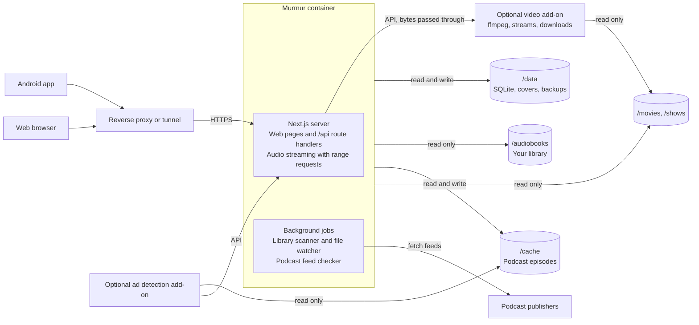

# Architecture

## Tech stack

| Layer | Choice | Why |
| --- | --- | --- |
| Server and web UI | Next.js (App Router), self-hosted with `standalone` output | Route handlers serve the API, pages serve the web player |
| Database | SQLite via `better-sqlite3` + Drizzle ORM | A single file in `/data`; typed queries and migrations |
| Background jobs | Started from `instrumentation.ts` with `node-cron` and `chokidar` | Feed checks and library watching inside the same process |
| Audio metadata | `music-metadata` (pure JavaScript, no ffmpeg) | Reads tags, duration, chapters and embedded covers from m4b, mp3, flac and ogg/opus |
| Video | `ffmpeg` and `ffprobe`, with the VAAPI drivers, in the video add-on's image (`addons/video`) | Reads video files, grabs stills, and makes HLS streams and downloads; only Watch needs them, and Murmur's own image has no ffmpeg |
| RSS | `rss-parser` | Parses podcast feeds and iTunes tags |
| Auth | Session cookie for web, bearer token for the app; passwords hashed with argon2 | Simple, no external provider |
| Web styling | Plain CSS with custom properties (`apps/server/src/app/globals.css`) | Light and dark themes without a build step |
| Android app | Expo (React Native) + Expo Router | React and TypeScript; shares types with the server |
| App playback | `expo-audio` | Background audio, lock-screen and notification controls, Bluetooth buttons |
| App downloads | `expo-file-system` | Offline books, episodes, music, movies and TV episodes |
| App data | TanStack Query persisted to `expo-sqlite` key-value storage | Cached lists that open offline, offline progress queue |
| Shared code | `packages/shared`: API types and Zod schemas | One definition used by server, web and app |
| Repo | pnpm workspace monorepo | `apps/server`, `apps/mobile`, `packages/shared`, `addons/adscan`, `addons/video` |

All dependency versions are pinned; upgrades happen deliberately, not on every rebuild. What a build downloads is checked against a known hash: base images by digest, pnpm by its `packageManager` hash, the ad add-on's Python packages with `--require-hashes`, its Vosk model with `ADD --checksum`, and the Gradle wrapper by `distributionSha256Sum`. pnpm refuses npm versions published less than seven days ago (`minimumReleaseAge`), and Dependabot moves the pins on monthly.

## How it fits together

Everything runs in one Next.js process: the web pages, the JSON API the app calls, audio streaming and the background jobs.

Podcast episodes are served from the server's episode cache, falling back to relaying the publisher's audio with range requests. The optional ad detection add-on runs as a second container (see [Podcasts and ad detection](podcasts.md)), and so does the video add-on (see Watch).

**Data model** (SQLite)

| Table | Holds |
| --- | --- |
| `users` | Username, password hash, admin flag |
| `sessions` | Web sessions and app tokens |
| `library_folders` | The folders the library is read from |
| `books` | Title, author, narrator, series, position, description, duration, cover path, library folder and path inside it, file hash |
| `book_files` | Each audio file in a book: path, order, duration, start offset |
| `chapters` | Title, start and end time per book |
| `podcasts` | Feed URL, title, author, artwork, last checked |
| `episodes` | GUID, title, publish date, duration, audio URL, chapters file URL and the chapters found (unset until looked up, empty when there are none) |
| `progress` | Per user and item: position, finished flag, last updated, speed |
| `up_next` | Per user: Up Next as one running list of episodes and songs, with the one playing |
| `play_next` | Per user: the ordered Play next books |
| `episode_files`, `episode_ads`, `ad_scans` | The episode cache and ad times (see [Podcasts and ad detection](podcasts.md)) |

**API** (all under `/api`, JSON, token or cookie auth)

| Area | Endpoints |
| --- | --- |
| Auth | `POST /auth/setup` (first run only), `POST /auth/login`, `POST /auth/logout`, `GET /me`, `GET/PUT /me/prefs` |
| Library | `GET /books`, `GET /books/:id`, `GET /books/:id/cover`, `POST /library/scan` |
| Book editing (admin) | `GET /books/:id/edit`, `PUT /books/:id/details`, `PUT /books/:id/chapters`, `POST/DELETE /books/:id/cover`, `POST /books/:id/rescan`, `GET/POST/DELETE /books/:id/match` |
| Streaming | `GET /stream/book/:id/:fileIndex`, `GET /stream/episode/:id` (range requests) |
| Podcasts | `GET/POST /podcasts`, `GET /podcasts/search?q=` (directory search, marks podcasts you follow), `GET /podcasts/preview?feedUrl=` (reads a feed without subscribing), `DELETE /podcasts/:id`, `GET /podcasts/:id/episodes`, `POST /podcasts/:id/refresh`, OPML import and export |
| Progress | `GET /progress?since=`, `PUT /progress` (batched, newest update wins) |
| Up Next | `GET /up-next`, `PUT /up-next` (the whole list), `PATCH /up-next` (where it's at), `POST /up-next` (add one item, or several in order) |
| Play next | `POST/DELETE /books/:id/play-next`, `PUT /play-next` (order) |
| Admin | `GET/POST/DELETE /users`, `GET /library/admin` (You > Library's counts and scans), `GET /library/folders` |
| Video editing (admin) | `PATCH /watch/{movies,shows}/:id` (title, year, description), `POST /watch/{movies,shows}/:id/{poster,backdrop}` (upload, `{ url }` or `{ tmdbPath }`), `DELETE` the same to remove a chosen one, `GET .../{poster,backdrop}/options` (TMDB's pictures) |
| Episode cache, chapters and ads | `GET /episodes/:id/chapters`, `GET /episodes/:id/ads`; admin: `GET/PUT /server/cache`, `POST /server/ads/retry` |
| Add-on (shared secret) | `POST /addon/ads/next`, `POST /addon/ads/:fileId`, `POST /addon/status` |
| Casting | `POST /cast` `{ paths }` (prefixes of one item's stream and cover) returns `{ base, expiresAt }`; the Chromecast opens `base` + an API path (see [Casting](casting.md)) |
| Changes | `GET /changes`: a 204 whose `x-murmur-changes` header is `boot.books.music.watch.busy`, a count per kind that goes up as scans and matching add or change things, and whether one is running. `src/proxy.ts` puts the same header on every API answer. Clients (`createChangesPoller` in shared) ask every 3 s while busy and every 10 minutes otherwise, only while in front, take the header from calls they make anyway, and reload a kind's lists when its count moves, so new items appear as they're scanned and posters as they're matched |
| Health | `GET /health`: `ok` and the version with no token (Docker's check, the app recognising a server); signed in, also database, library, scan and watcher status, the add-ons and the video status. A token that no longer works gets a 401, so a client never reads the short answer as the full one |

Conflicts in progress sync resolve to the most recent update by timestamp, so listening offline on the phone and then online in the browser keeps the newer position.

## Performance and reliability

The bar is high: every screen opens instantly, playback starts in about a second, and nothing breaks without someone touching it.

**Targets** (a low-power home server with a 1,000-book library)

| Measure | Target |
| --- | --- |
| Server cold start to ready | under 3 s |
| Library list API, p95 | under 50 ms |
| Playback start, LAN / remote | under 1 s / under 2 s |
| Full rescan, nothing changed | under 5 s |
| Memory at idle | under 200 MB |
| Docker image size | under 350 MB |
| App: library screen open, cached | under 300 ms, works offline |

### Server speed

- SQLite in WAL mode with indexes on every lookup column; the library list is one query, not one per book.
- No transcoding: audio is streamed byte for byte with range requests, so playback costs almost no CPU.
- Covers are resized once at scan time (200 px and 600 px WebP) and served with a content hash in the URL and a one-year immutable cache header.
- JSON responses carry ETags, so unchanged data returns `304 Not Modified` with no body.
- Incremental scans: only files whose size or modified time changed are probed again, at most 2 at a time so a big import doesn't swamp the disk.
- Progress updates are tiny writes, debounced on the client to one every 10 s plus on pause.

### App speed

- Library, podcasts and progress are cached on the phone, so screens draw from local data first and refresh in the background.
- Long lists use virtualized rendering (FlashList); covers load through `expo-image` with disk caching.
- Progress is written on the phone first and synced after, so a flaky connection never stalls the player.

### Safeguards

- **Never lose progress.** Progress rows are never deleted when a book disappears; if the book comes back, so does your place.
- **Survive a storage hiccup.** If a library folder is empty or unreachable, the scanner leaves its books alone and reports the problem in Settings; the other folders still scan. Missing books are marked missing and only hidden after 7 days. A folder whose mount is taken out of the compose file is dropped on the next start, and its books go on the next scan, unless they turn up in another folder, which keeps their progress.
- **Safe updates.** Migrations run in a transaction after copying the database to `/data/backups`; a failed migration rolls back and the old image still works.
- **Nightly backup** of the database to `/data/backups`, keeping the last 7. You > Server shows admins when the newest one was written, read from the folder so it survives a restart, and warns when the last try failed or none has run for two days. A test upgrades a 0.7 database, with data in it, through every migration since. Restoring is in [Getting started](../GETTING_STARTED.md#backups-and-restoring).
- **Health check.** `/api/health` answers `ok` and the version to anyone, for Docker's health check; the library, scan and add-on details are only for someone signed in, since scan errors name folders. A fatal error exits the process so the restart policy brings it back.
- **Addresses people give Murmur** (feeds, their audio and artwork, a cover URL) go through `safeFetch` (`server/safe-fetch.ts`): the host is looked up and refused when it points at the server itself (loopback, link-local) or, unless `FETCH_ALLOW_PRIVATE` is set, its LAN; every redirect is checked the same way; bodies are read up to a cap. Feed enclosure types are kept only from a list of audio types, so nothing a feed says is ever served as a page, and every response carries `nosniff`. Sign-in failures are limited per name and per address, and a session unused for over a year ends on the server too.
- **Files stay in their folders.** A stored path is joined onto its library folder and resolved with symlinks followed (`resolveInside`); a link inside a library folder that points outside it is refused. Search boxes sent to Match are capped at 200 characters.
- **Errors in plain words.** What people see never quotes another program: a feed that fails shows a plain reason (`feedProblem`), and the video add-on answers with its own words while ffmpeg's go to its log, since both can name addresses or paths on the server.
- **Outside artwork through the server.** Search results and previews show Apple's and the publisher's artwork through `/api/podcasts/artwork`, so browsers and phones never contact those hosts. Its links are signed (HMAC with the server's own key), so it only fetches images the server handed out: at most 5 MB, images only, never SVG.
- **Clean shutdown.** On stop, pending writes are flushed and the database closed, so a redeploy can't corrupt it.
- **Podcast feeds are isolated.** Each check has a 15 s timeout, retries with backoff, and uses conditional requests; one broken feed never blocks the rest.
- **Bounded logs**: one JSON line per event to stdout, rotated by Docker's log settings.
- **Few dependencies,** all pinned.
- **Tested before release.** A small set of unit tests covers the rules that matter most (folder and title parsing, file ordering, chapter timing, episode chapter parsing, range requests, match scoring, cache eviction, ad spans); no integration tests. CI must pass before an image is published.

---

| [← Features](features.md) | [Contents](README.md) | [Library scanning →](library.md) |
| :--- | :---: | ---: |
